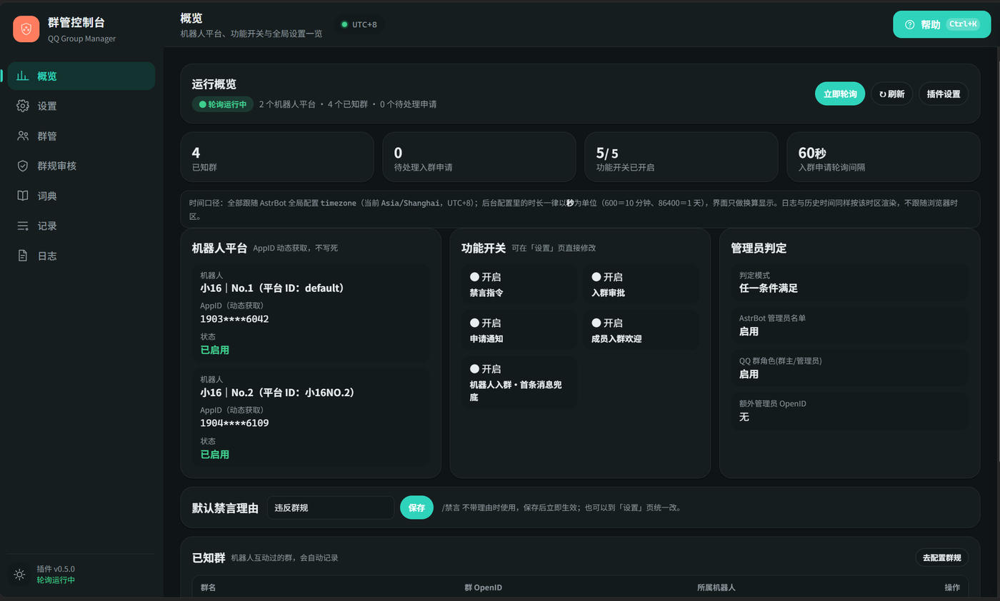
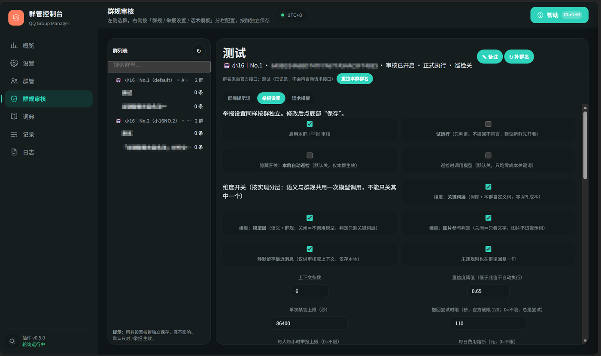
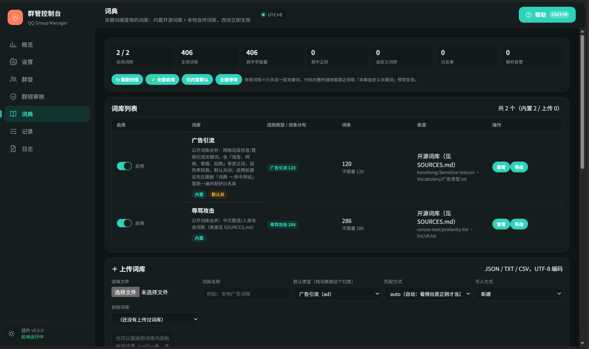

# QQ官机群管 · QQ 官方机器人群管理插件（astrbot_plugin_qq_group_manager）

> 🎯 **只支持腾讯 QQ 官方机器人**（AstrBot 的 `qq_official` / `qq_official_webhook` 平台适配器，走腾讯 QQ 开放平台 API）。
> OneBot v11 / NapCat / Lagrange / go-cqhttp 等第三方协议端**不支持**，装到那些账号上不会工作。
> 涉及 `openid`、官方审批策略、`event_id` 等功能的地方，全是官方 API 独有的行为。

> 🈶 **界面语言**：**简体中文**。插件面向中文社群，面板与帮助中心全部中文，不做多语言维护
> （多语言方案曾实现于 1.2.x 开发期，因渲染层按中文原文匹配、维护成本高而移除，详见 CHANGELOG）。

> 💬 **欢迎交流**：用着不顺手、想加功能、发现了 bug，都欢迎直接
> [提 Issue](https://github.com/Canoe16type/astrbot_plugin_qq_group_manager/issues/new/choose)
> 或发邮件到 **oc16games@outlook.com**。不用纠结格式，说清「做了什么、期望什么、实际什么」就够。

> 🤖 **AI 辅助编写声明**：本插件的代码与文档由 AI 辅助生成，经人工审核与实测后发布。
> 如有与描述不符的表现，请按下方[反馈与交流](#反馈与交流)告知。

> 📖 **想了解细节？** 本文只讲「怎么快速用起来」。完整的配置项含义、指令边界条件、四种维度的判定逻辑、
> 九页签面板每一项的作用，都在 **[详细手册 docs/GUIDE.md](docs/GUIDE.md)** 里。

> ⚠️ **重要：开启「群成员事件」会让机器人短暂断连（正常现象）**
>
> 入群 / 退群事件依赖运行时注入订阅（intent `1<<24`，`GROUP_MEMBER_ADD` / `GROUP_MEMBER_REMOVE`），
> 插件启用该订阅时会触发一次 **WebSocket 受控重连**。表现为：**首次开启的瞬间（以及重载导致订阅重新注入时），
> 机器人可能断开几秒到十几秒**，期间收发消息中断，重连完成后自动恢复，**不需要重启 AstrBot**。
> 建议在群内不活跃的时段开启；如果你跑着主动消息推送等敏感业务，请避开这个时间窗口。

基于 QQ 官方机器人平台（`qq_official`）的群管理插件：禁言、撤回、入群审批、欢迎语、成员档案、群规审核，
自带 WebUI 管理面板。**不修改 AstrBot 本体代码、零第三方依赖。**

| 项目 | 说明 |
| --- | --- |
| 支持平台 | `qq_official`（WebSocket）／`qq_official_webhook`（Webhook） |
| 依赖 | AstrBot 4.16 ~ 4.x（实测 4.29.4），无需额外 pip 包 |
| 许可 | MIT（见 [LICENSE](LICENSE)） |

---

## 功能一览

| 模块 | 能做什么 |
| --- | --- |
| 禁言 | `/群管 禁言` 多时长写法 + 理由；`禁言 解除`、`禁言 名单`、`禁言 历史`（按成员 / OpenID 前缀查）；旧写法 `/群管 解禁`、`/群管 查禁言`、`/群管 禁言历史` 仍可用（**1.6.0 移除**） |
| 撤回 | 引用消息撤回或按消息 ID 撤回；原始消息本地留存，超 2 分钟受官方限制 |
| 入群审批 | 申请一提交就推群通知（`GROUP_JOIN_REQUEST` 事件为主、低频轮询兜底），通知带「通过 / 拒绝」**按钮**点一下即审批；也可用 `/群管 审批`、`/群管 审批 通过`、`/群管 审批 拒绝`（旧写法 `/群管 通过`、`/群管 拒绝` 仍可用，**1.6.0 移除**）；另有官方「入群自动审批策略」的列表与编辑 |
| 欢迎语 | 审批通过的欢迎语、机器人入群自我介绍 |
| 成员档案 | `member_openid ↔ 昵称/备注` 对照表，解决官方不给昵称的问题；退群通知从中取名 |
| 退群回收 | 机器人被移出群（`GROUP_DEL_ROBOT`）后自动删掉该群的成员档案、群规、判定记录、禁言/撤回历史等；`bot_state` 二次确认，查不了（`11253`）不误删；`/群管 状态 群` 可手动巡检 |
| 群规审核 | 引用违规消息发 `/群管 举报`，四维度判定 → 自动撤回 + 禁言 + 说明依据 |
| 判定留痕 | 每条判定都存原文（前 1000 字）+ 耗时/token + 结论；记录页点「原文」看详情、可导出 CSV、可标「误判 / 正确」（标注会持久化进提示词示例） |
| 成本防护 | 同群模型调用排队上限（默认 3）、单次超时（默认 45s）、每日调用熔断（默认 500 次）；`/群管 状态 自检` 一条命令看清链路与用量 |
| 权限判定 | AstrBot 管理员 / QQ 群角色 / 自定义 OpenID，任选组合 |
| 词典 | 2 个最小内置词库（406 条）、上传自定义词库、白名单、命中测试 |
| 管理面板 | 九个页签，配置可搜可分组编辑，多数即时生效 |

界面预览（示例数据，不含真实群号 / openid）：

| 概览 | 群规审核 | 词典 |
| --- | --- | --- |
|  |  |  |

---

## 快速开始

**第一步：群侧四项设置（决定功能上限，每个群都要设）**

| 设置 | 要求 | 说明 |
| --- | --- | --- |
| 群聊消息范围 | 群主设为「获取群内全部消息」 | 否则机器人只收到 @ 它的消息 |
| 事件订阅 | 开放平台 → 回调配置勾选 `GROUP_MESSAGE_CREATE` | Webhook 模式必做 |
| 机器人身份 | 设为群管理员 | 决定能否撤回他人消息，未设会报 `11703` |
| 撤回时限 | 官方硬限制 2 分钟（`40064004`） | 管理员只扩大「能撤谁」，不延长时限 |

**第二步：装插件、发指令**

1. 插件目录放进 AstrBot 的 `plugins/`（别多套一层），重启或重载；
2. 群里发 `/群管` 看指令树，发 `/群管 帮助` 看用法。

> 只发 `/群管` 会先提示「参数不足」再列指令——这是 AstrBot 指令组的默认行为，不是报错。

---

## 安装与升级

- **插件市场**：WebUI → 插件 → 插件市场 → 搜「QQ官机群管」→ 安装（自动处理版本与更新）；
- **手动**：把 `astrbot_plugin_qq_group_manager` 放进 `plugins/` → 重启或重载。

**升级**：先备份插件目录与 `data/config/astrbot_plugin_qq_group_manager_config.json`，再覆盖。
完整变更见 [CHANGELOG.md](CHANGELOG.md)。

---

## 指令速查

指令统一在指令组 `/群管` 下，写法 `/群管 <子指令>`；不带 `/` 时必须 @ 机器人。
**指令名与被 @ 成员之间要有空格**：`/群管 禁言 @某人 10分钟` ✅，`/群管 禁言<@某人>10分钟` ❌。

| 指令 | 用途 |
| --- | --- |
| `/群管 禁言 @用户 时长 [理由]` | 时长支持 `10分钟` / `2小时` / `1天`，与理由顺序可互换；同时 @ 多人只处理第一个 |
| `/群管 禁言 解除 @用户` `/群管 禁言 名单` `/群管 禁言 历史 [条数\|汇总] [@用户\|OpenID前缀]` | 解禁（可一次 @ 多人）、当前禁言名单、禁言历史流水（默认最近 10 条） |
| `/群管 审批 [页码\|全部]` `/群管 审批 通过 序号\|昵称` `/群管 审批 拒绝 序号\|昵称 [理由]` | 入群申请（`全部` 跨群汇总，可加页码）；通过 / 拒绝带按钮通知时也可直接点 |
| `/群管 状态 [日报\|群 [清理]\|自检\|群名]` | 不带参数＝群管日报（待处理申请 + 禁言人数）；`群`＝机器人还在不在已记录的群里；`自检`＝审核链路与用量；`群名`＝刷新本群群名 |
| `/群管 撤回` | 引用消息后发送；或 `/群管 撤回 <message_id>` |
| `/群管 群规 [列表\|添加\|设置\|删除\|清空]` | 添加示例：`/群管 群规 添加 刷屏 \| 连续刷无意义内容 \| 10分钟`（半角 / 全角竖线、纯空格均可） |
| `/群管 审核 [试跑\|巡检\|测试\|自我介绍]` | 诊断入口，看状态、切换试运行、试判一条内容 |
| `/群管 成员` | 成员档案查询与维护 |
| `/群管 管理登记 [列表\|取消]` | 主动登记为审核提醒名单，变体累计提醒只 @ 名单内的人 |
| `/群管 举报` | 引用违规消息触发审核（全体成员可用） |
| `/群管 帮助` | 完整指令速查（面板里也有一份可视版） |

### 指令迁移说明（重要）

1.5.0 起，功能相近的指令合并成 5 个大类（禁言 / 审批 / 状态 / 审核 / 群规），**同一功能有新旧两种写法**：

- **现在**：新旧写法**都能用**，行为、参数、权限完全一致；**但请优先用新写法**，本文档所有示例都已改成新写法。
- **1.6.0 起**：**旧写法全部移除**（不只是文档不写，插件里也不再兼容），届时还敲旧指令会直接失效。

| 旧写法（1.6.0 移除） | 新写法（推荐，1.5.0 起） |
| --- | --- |
| `/群管 解禁 @用户` | `/群管 禁言 解除 @用户` |
| `/群管 查禁言` | `/群管 禁言 名单` |
| `/群管 禁言历史 [汇总] [@用户]` | `/群管 禁言 历史 [汇总] [@用户]` |
| `/群管 通过 N` | `/群管 审批 通过 N` |
| `/群管 拒绝 N [理由]` | `/群管 审批 拒绝 N [理由]` |
| `/群管 汇报` | `/群管 状态` |
| `/群管 体检 [清理]` | `/群管 状态 群 [清理]` |
| `/群管 自检` | `/群管 状态 自检` |
| `/群管 群名` | `/群管 状态 群名` |

需要提醒的是：`/群管 审批`、`/群管 审核`、`/群管 群规`、`/群管 撤回`、`/群管 举报`、`/群管 成员`、
`/群管 管理登记`、`/群管 帮助` 这 8 个指令**一直没变**，只是子命令更规整了。

权限：`/群管`、`/群管 帮助`、`/群管 举报`、`/群管 群规`（只读）全员可用，其余需管理员。
管理员判定由「判定模式 + 启用条件」组成：`any`（默认，满足任一）或 `all`（全部满足）；
条件可选 AstrBot 管理员 / QQ 群角色 / 自定义 OpenID。生效群范围由 `basic.target_group_openids` 控制，
留空＝所有群，也支持 `机器人实例ID:群OpenID` 只让指定机器人管。

---

## 群规审核怎么工作

> 核心约定：**只有收到 `/群管 举报` 才进入审核**，平时不扫描、不判定。

判定分四层，前两层零成本：

| 维度 | 依据 | 成本 |
| --- | --- | --- |
| 关键词 | 自定义关键词 / 本地词库 / 内置套路正则 | 零成本 |
| 群规 | 命中本群某条规则 | 无额外成本 |
| 语义分析 | 结合上下文（人身攻击、阴阳怪气等） | 调模型 |
| 图片识别 | 被举报消息含图片 | 调多模态模型 |

**时长由代码算，模型无权指定**：命中群规取规则时长；未命中时按严重度（低 10 分钟 / 中 1 小时 / 高 1 天）；
不足 60 秒用兜底时长（默认 600 秒）；上限默认 1 天。

**默认是试运行**：只判定并回话术、不撤回不执行，确认误判率可接受后再关掉试运行。
置信度阈值默认 `0.75`，低于阈值只记录不执行；记录在面板「记录 → 判定记录 / 试跑」，误判可一键标记。

**变体检测**（`袋刷单`、`加·微·信` 这类绕写）只产疑似、**永不自动禁言**，累计后提醒登记过的管理员；
待办队列与复犯累进在同一处配置。开关、阈值、豁免名单、关键词都**按群独立**，改完立即影响下一次判定。

**为什么显示 OpenID 而不是昵称**：官方成员信息接口 `GET /v2/groups/{gid}/members/{openid}` 需要额外权限，
多数应用返回 `11253`，插件静默降级显示 OpenID，不影响禁言 / 撤回 / 审批。用「成员档案」手动补名字即可。

> 想弄清四种维度怎么加权、阈值与试运行怎么配合、豁免名单和复犯累进的实际效果，见
> **[详细手册 docs/GUIDE.md](docs/GUIDE.md)** 的「群规审核」章节。

---

## 配置要点

配置分组与插件设置页一一对应，多数保存后即时生效：

| 分组 | 关键项 |
| --- | --- |
| 基础功能 | 启用禁言指令、默认禁言理由、生效群范围、入群欢迎、机器人入群自我介绍 |
| 权限判定 | 判定模式（any / all）、AstrBot 管理员、QQ 群角色、额外 OpenID |
| 群规审核 | 启用审核、审核模型、多模态模型、兜底时长、通用禁止项、模型单价（仅面板统计花费） |
| 入群审批 | 启用审批、新申请群内通知、申请获取方式（事件为主 / 纯轮询 / 仅事件）、兜底轮询间隔（默认 300 秒）、通知带审批按钮、按钮可点范围、**定时汇报**（每天 `HH:MM` 按群逐个推日报，只发有未处理申请的群） |
| 撤回 | 启用撤回、每群历史上限（`0`＝不限） |
| 消息模板 | 所有群内文案，支持 `{变量}` 与内置模块 `{at}`（@群员）、`{avatar}`（群员头像，可写 `{avatar:40}` 小图 / `{avatar:160}` 大图，需 Markdown 格式），留空用默认。此处保存会写全局话术，实际渲染优先级：**本群话术 > 全局话术 > 插件配置 > 内置默认** |
| 群成员事件 | 入群 / 退群订阅，见顶部⚠️提示；退群通知默认发主动消息 |
| 日志 | 级别（排障用 DEBUG）、内存条数、是否落盘、保留天数（默认 14 天） |

> 每个配置项的完整含义、取值范围与踩坑点 → **[详细手册 docs/GUIDE.md](docs/GUIDE.md)** 的「插件配置说明」章节。

---

## 管理面板

插件详情页打开，单页九页签：**概览 / 设置 / 群管 / 入群审批 / 群规审核 / 成员档案 / 词典 / 记录 / 日志**。

| 页签 | 内容 |
| --- | --- |
| 概览 | 平台信息、功能开关速览、管理员判定、已知群列表 |
| 设置 | 配置项搜索与分组保存，含帮助中心入口 |
| 群管 | 待处理申请（带角标）与当前禁言成员 |
| 群规审核 | 选群后三子页：群规提示词 / 举报设置（变体检测、待办队列、复犯累进）/ 话术模板 |
| 成员档案 | 改昵称、加备注、批量导入（`openid,昵称,备注`）、清理已退群、官方同步 |
| 词典 | 词库开关、预览、导出、上传、白名单、命中测试 |
| 记录 | 禁言历史 / 撤回历史（含原文）/ 判定记录与试跑统计 |
| 日志 | SSE 实时刷新，显示磁盘日志占用与清理天数 |

> 「全员禁言模式」拆成 `模式 · 状态`：`始终禁言 / 定时禁言` + `生效中 / 已启用 / 未生效`，
> 官方只告知配置过哪种类型，`mode=schedule` 不代表正在禁言。

---

## 常见问题

**1. 插件加载失败 / WebUI 看不到插件**
目录层级不对或 `metadata.yaml` 不完整。确认路径是 `plugins/astrbot_plugin_qq_group_manager/`，
`name` 与目录一致，`astrbot_version` 满足当前版本；再看 AstrBot 日志的报错。

**2. 指令没反应 / 提示无权限**
逐项确认：管理员判定条件、`basic.target_group_openids` 生效范围、指令格式（不带 `/` 时是否 @ 了机器人）、
对应功能开关是否打开。

**3. 禁言 / 撤回报错**
`11703` 机器人不是管理员；`40064004` 超过 2 分钟撤回时限；`40062003` 非管理员撤他人消息；
`11253` 接口无权限（成员信息、群列表等内邀能力），属正常降级。

**3.1 入群申请没有通知 / 点按钮没反应**
申请通知的主通道是 `GROUP_JOIN_REQUEST` 事件，**机器人必须是群管理员**，否则平台不推、轮询也报 `11703`。
事件没来就等兜底轮询（默认 300 秒），也可发 `/群管 审批` 手动拉一次。
按钮点不动多半是「按钮可点范围」设成了 `admin`（仅群主/管理员）；点了没反馈则是当前 AstrBot
不支持按钮事件（启动日志有告警），先用 `/群管 审批 通过 <序号>`。

**4. 退群 / 入群通知不生效**
先确认「群成员事件」已开启（配置项 `member_event.enable_member_remove_notify`），
开启后按顶部说明会有一次重连；仍收不到通常是平台侧未给该机器人推送该事件。
退群事件不带 `event_id`，无法被动回复，因此默认发主动消息，需要主动消息额度。

**5. 设置改了没生效**
面板里标「即时生效」的项保存即生效；涉及事件订阅的改动需要重载插件（会触发一次重连）。

**6. 明明违规却没处理**
看判定记录里的置信度是否低于阈值、是否还开着试运行、该成员是否在豁免名单、消息是否已超撤回时限。

**7. 成员列表只显示 OpenID**
见上文 `11253` 说明，用「成员档案」补昵称，不影响功能。

**8. 卸载后数据还在？**
插件只删自己的目录，`data/plugin_data/astrbot_plugin_qq_group_manager/` 与配置文件会保留，需手动删除。

更多排障细节见 [CHANGELOG.md](CHANGELOG.md) 对应版本说明。

> 每条 FAQ 的完整成因、判断路径与边界情况（含 `11703` / `40064004` / `40062003` / `11253` 逐个解释）
> → **[详细手册 docs/GUIDE.md](docs/GUIDE.md)** 的「常见问题（FAQ）」章节。

---

## 数据与日志位置

| 内容 | 路径（相对 AstrBot 数据目录） |
| --- | --- |
| 插件配置 | `config/astrbot_plugin_qq_group_manager_config.json` |
| 群列表 / 成员档案 / 禁言历史 / 撤回历史 | `plugin_data/astrbot_plugin_qq_group_manager/` 下 `known_groups.json`、`members.json`、`mute_history.json`、`recall_history.json` |
| 群规、审核设置、判定记录 | `plugin_data/astrbot_plugin_qq_group_manager/mod_*.json` |
| 词库与启用状态 | `plugin_data/astrbot_plugin_qq_group_manager/lexicons/`、`lexicon_state.json` |
| 文件日志 | `plugin_data/astrbot_plugin_qq_group_manager/astrbot_plugin_qq_group_manager_YYYYMMDD.log`（默认留 14 天） |

机器人被移出某个群（或 `/群管 状态 群 清理` 检出离群）时，插件会把这个群在上述文件里的记录删掉——
只删该群，其他群不动；想留档就在那之前备份。`basic.enable_group_del_purge` 关掉可只记日志不删数据。

卸载前请备份上述目录与配置文件。

---

## 反馈与交流

| 类型 | 怎么反馈 |
| --- | --- |
| 功能建议 / 使用疑问 | [新建 Issue](https://github.com/Canoe16type/astrbot_plugin_qq_group_manager/issues/new/choose) |
| 疑似 bug | [新建 Issue](https://github.com/Canoe16type/astrbot_plugin_qq_group_manager/issues/new/choose) 选「功能异常」，附插件版本、AstrBot 版本、复现步骤、日志 |
| 安全漏洞 | **不要开公开 Issue**：[私密报告](https://github.com/Canoe16type/astrbot_plugin_qq_group_manager/security/advisories/new) 或邮件 **oc16games@outlook.com**（见 [SECURITY.md](SECURITY.md)） |
| 其他 / 单纯想聊 | 邮件 **oc16games@outlook.com** |
| 更新记录 | [CHANGELOG.md](CHANGELOG.md) |

> 贴日志前请删掉 **AppID / AppSecret / openid / 群号 / 成员昵称**。
> 日志位置：面板「日志」，或 `data/plugin_data/astrbot_plugin_qq_group_manager/*.log`；容器部署再加 `docker logs`。

---

## 声明

- **AI 辅助编写**：代码与文档由 AI 辅助生成，经人工审核与测试后发布，仍可能存在疏漏，欢迎反馈。
- **零侵入**：只使用 `astrbot.api` 公开层，不改 AstrBot 与 botpy 代码文件；不替用户修改全局配置。
- **词库免责**：内置词库是**本地审核用黑名单**，只在本机匹配拦截，不对外提供、不生成、不上传，面板与日志不展示词条文本；
  词条由 `tools/build_lexicons.py` 从公开开源项目生成（见 [lexicons/SOURCES.md](lexicons/SOURCES.md)），
  上游社区维护，**可能误伤或漏词，作者不作保证**，是否启用由使用者判断并承担责任。
- **使用边界**：本插件是辅助工具，不能替代平台审核义务与人工管理；使用须符合当地法律与平台规则。

---

## 许可证

[MIT](LICENSE) © Canoe16type
