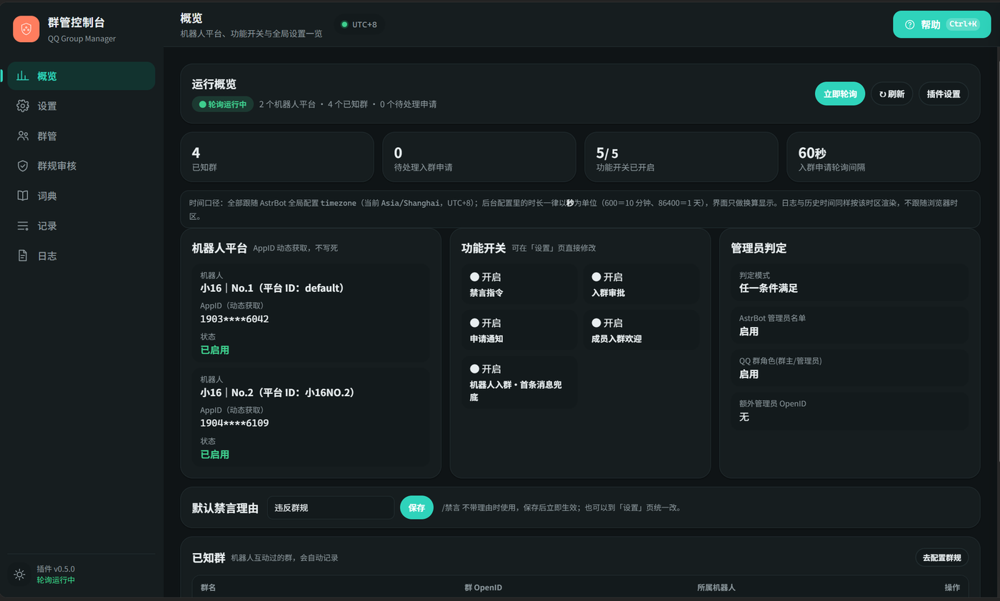
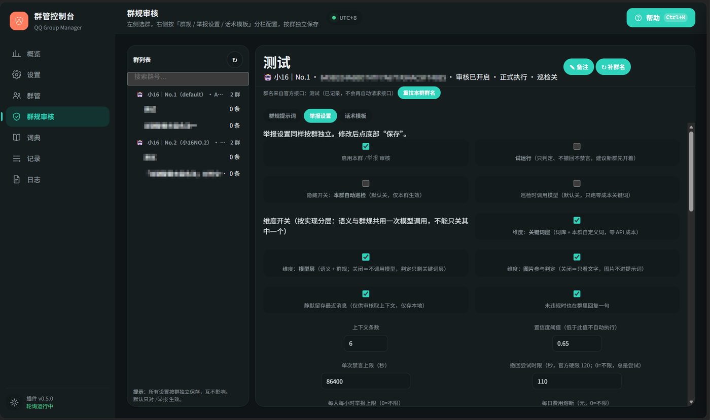
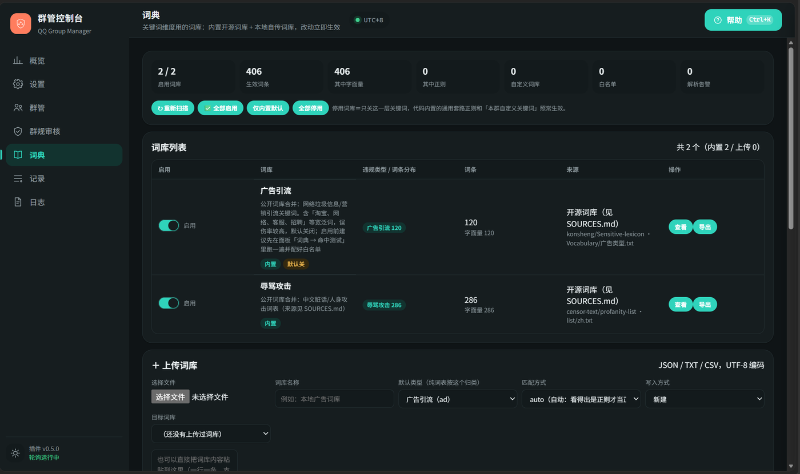

# QQ 群管理插件（astrbot_plugin_qq_group_manager）


[](LICENSE)
[](CHANGELOG.md)
[](#快速开始)
[](#快速开始)
[](#安装与升级)
[](https://github.com/Canoe16type/astrbot_plugin_qq_group_manager/actions/workflows/ci.yml)

> **免责**
>
> - 内置词库是**审核用黑名单**，只在本机匹配拦截，不对外提供、不生成、不上传；面板与日志都不展示词条文本。
> - 词条由 `tools/build_lexicons.py` 从公开开源项目生成（见 [lexicons/SOURCES.md](lexicons/SOURCES.md)），
>   上游社区维护，**可能误伤或漏词，作者不作保证**；是否启用由使用者自行判断并承担责任。
> - 本插件是辅助工具，不能替代平台审核义务与人工管理；使用须符合当地法律与平台规则。

基于 QQ 官方机器人平台（`qq_official`）的群管理插件：禁言、入群审批、欢迎语、消息撤回、群规审核，内置 WebUI 管理面板与实时日志。

| 项目 | 说明 |
| --- | --- |
| 支持平台 | `qq_official`（QQ 官方机器人平台） |
| 依赖 | AstrBot 4.16 ~ 4.x（实测 4.29.1）、QQ 官方机器人平台适配器 |
| 许可 | MIT License（见 [LICENSE](LICENSE)） |

不修改 AstrBot 本体代码；AppID / AppSecret 从当前平台自动获取。
> **AI 生成声明**：本插件由 AI 生成，代码经人工审核与测试后发布。

---

## 目录

1. [快速开始](#快速开始)
2. [功能总览](#功能总览)
3. [界面预览](#界面预览)
4. [安装与升级](#安装与升级)
5. [权限说明](#权限说明)
6. [指令手册](#指令手册)
7. [群规审核（`/群管 举报`）](#群规审核群管-举报)
8. [词典（关键词词库）](#词典关键词词库)
9. [插件配置说明](#插件配置说明)
10. [管理面板](#管理面板)
11. [常见问题（FAQ）](#常见问题faq)
12. [数据与日志位置](#数据与日志位置)
13. [用了哪些 AstrBot 接口](#用了哪些-astrbot-接口)
14. [版本记录](#版本记录)

---

## 快速开始

1. 把 `astrbot_plugin_qq_group_manager` 目录放进 AstrBot 的 `plugins/`（不要多套一层），重启或重载插件；
2. **群主**在手机 QQ → 群设置 → 机器人 → 把「机器人可获取的群聊消息范围」设为**获取群内全部消息**；
3. **群主**把机器人设为群管理员（否则无法撤回他人消息）；
4. 群里发 `/群管` 验证。

这四项决定功能上限，每个群要分别设置：

| 项目 | 要求 | 说明 |
| --- | --- | --- |
| 群聊消息范围 | 群主设为「获取群内全部消息」 | 未开启时机器人只收到 @ 它的消息，上下文判定与引用回溯不完整 |
| 事件订阅 | QQ 开放平台 → 开发 → 回调配置，勾选 `GROUP_MESSAGE_CREATE` | Webhook 模式必做，否则收不到全量群消息事件 |
| 机器人身份 | 设为群管理员 | 只决定能否撤回**普通成员**的消息；未设置时面板禁言列表会报 `11703`（[例图](docs/screenshots/05-faq-11703.png)） |
| 撤回时限 | 官方硬限制：超过 **2 分钟**不可撤回（`40064004`） | 与管理员身份无关，管理员只扩大「能撤谁」 |

> 想验证实际权限：把「撤回尝试时限」填 `0`（不限，总是尝试），失败原因会写进审核记录。

---

## 功能总览

| 模块 | 能力 |
| --- | --- |
| 禁言管理 | `/群管 禁言`（多种时长写法 + 可选理由）、`/群管 解禁`、`/群管 查禁言`；禁言历史可按成员 / OpenID 查 |
| 消息撤回 | `/群管 撤回` 引用撤回或按消息 ID 撤回；原始消息本地留存 |
| 入群审批 | `/群管 审批` 查看、`/群管 通过` `/群管 拒绝` 操作；轮询新申请并在群内通知 |
| 欢迎消息 | 审批通过后的欢迎语；机器人首次进群自我介绍（事件优先 + 首条消息兜底） |
| 成员退群通知 | ⚠️ 暂不可用，平台未推送群成员事件（见 [FAQ](#5-退群通知不生效)） |
| 群规审核 | `/群管 举报` 触发四维度判定，违规自动撤回 + 禁言；群规、开关按群独立配置 |
| 权限判定 | AstrBot 管理员 / QQ 群角色 / 自定义 OpenID，三种条件可组合 |
| 词典 | 关键词层：2 个最小内置词库（406 条）+ 上传自己的词库 + 白名单 + 命中测试 + 给自己地址拉词表 |
| WebUI | 配置分组编辑（多数即时生效）+ 管理面板七页签 |
| 零侵入 | 不修改 AstrBot 本体代码 |

---

## 界面预览

管理面板在 AstrBot 插件详情页打开，七个页签：**概览 / 设置 / 群管 / 群规审核 / 词典 / 记录 / 日志**。

| 概览 | 群规审核 | 词典 |
| --- | --- | --- |
|  |  |  |

<sub>截图使用示例群名与演示数据，不含任何真实群号 / openid。</sub>

---

## 安装与升级

**安装（两种方式，选一）**：

- **插件市场**：AstrBot WebUI → 插件 → 插件市场 → 搜索「QQ 群管理」→ 安装（自动处理版本与更新）；
- **手动**：把 `astrbot_plugin_qq_group_manager` 目录放进 `plugins/` → 重启或重载。

装完在 WebUI 插件设置按需修改，插件详情页打开管理面板。

**升级**：先备份旧插件目录与 `data/config/astrbot_plugin_qq_group_manager_config.json`，再覆盖。

---

## 权限说明

管理员判定条件可组合，组合方式由「判定模式」决定：

- **any（默认）**：满足任一启用条件即为管理员；
- **all**：所有启用条件都满足才算管理员。

可启用的条件：① **AstrBot 管理员**（WebUI 配置的管理员用户 ID）；② **QQ 群角色**（群主 / 管理员）；
③ **自定义 OpenID**（插件配置里填写的名单）。

> 只启用「QQ 群角色」时，AstrBot 管理员在群里不算管理员；只启用「AstrBot 管理员」时，群主也得配好 ID 才能用指令。

**生效群范围**：`target_group_openids` 留空＝所有群生效；填写后只有这些群内的指令生效。

> **成员昵称接口有权限坑**：`GET /v2/groups/{gid}/members/{openid}` 需额外接口权限，多数应用返回
> `11253 应用无接口访问权限`。插件静默降级为显示 OpenID 或内存缓存，不影响禁言 / 撤回 / 审批
> （实测如此，面板里看到 OpenID 属正常现象）。

---

## 指令手册

所有指令统一收在指令组 `/群管` 下，写法是 `/群管 <子指令>`；AstrBot 面板里只会出现一条「群管」，展开即全部子指令。

**通用说明**：指令一律写成 `/群管 <子指令>`，参数空格分隔；不带 `/` 时**必须 @ 机器人**，否则当普通聊天。
**指令名与被 @ 的成员之间必须留一个空格**（`/群管 禁言 @某人 10分钟` ✅，`/群管 禁言<@某人>10分钟` ❌ 会被当成没带参数）。

**权限**：`/群管`、`/群管 帮助`、`/群管 举报`、`/群管 群规`（只读）全体可用；其余需管理员。

> 只发 `/群管` 会先回一句「参数不足」再列指令树——这是 AstrBot 对指令组的默认提示，不是报错。

**指令明细**

| 指令 | 写法 | 注意 |
| --- | --- | --- |
| `/群管 禁言` | `/群管 禁言 @用户 时长 [理由]`，如 `/群管 禁言 @小明 10分钟 刷屏` | 时长与理由顺序可互换；必须 @ 目标；不能禁言自己；同时 @ 多人只处理第一个；理由省略时用「默认禁言理由」 |
| `/群管 解禁` | `/群管 解禁 @用户` | 可一次 @ 多人，逐个处理并分别回复 |
| `/群管 查禁言` | `/群管 查禁言` | 数据来自插件本地缓存 |
| `/群管 禁言历史` | `/群管 禁言历史 [条数\|汇总] [@用户\|OpenID前缀]` | 默认最近 10 条（范围 1~50）；`汇总` 按成员统计；支持 OpenID 前 8 位以上前缀，适合查已退群用户。QQ 不提供历史查询，记录为插件本地保存 |
| `/群管 撤回` | 引用消息后 `/群管 撤回`；或 `/群管 撤回 <message_id>` | 超 2 分钟不可撤回（`40064004`）；非管理员只能撤自己的（`40062003`）；撤回记录写入 `recall_history.json`，引用撤回会留存原文，按 ID 撤回只有 ID |
| `/群管 审批` | `/群管 审批` | 列出待处理申请（序号、昵称、来源、时间、验证消息），缓存为空时自动拉取 |
| `/群管 通过` | `/群管 通过 序号\|昵称关键字` | 匹配列表中第一个包含该关键字的申请；开启欢迎时自动发欢迎语 |
| `/群管 拒绝` | `/群管 拒绝 序号\|昵称关键字 [理由]` | 理由会透传给官方接口 |
| `/群管 群规` | 见下 | 命令行添加的群规固定为「其他违规 / 中」；要精确设置类型与严重度请用面板 |
| `/群管 群名` | `/群管 群名` | 调群信息接口并入库，面板群列表优先显示（手动备注 > 接口群名）。打开面板**不会**自动请求；接口仅对白名单机器人开放，返回 `11253` 时用面板「✎ 备注」手动起名 |
| `/群管 审核` | 见下 | 诊断入口，不受维度开关限制 |

`/群管 群规` 子命令：

| 用法 | 说明 |
| --- | --- |
| `/群管 群规` 或 `/群管 群规 列表` | 列出本群群规（序号、名称、说明、类型、时长） |
| `/群管 群规 添加 规则名｜判定说明｜时长` | 添加一条 |
| `/群管 群规 设置 规则名｜说明｜时长 ; 规则名｜说明｜时长` | 批量追加（`;` 或换行分隔） |
| `/群管 群规 删除 序号\|id`；`/群管 群规 清空` | 删除一条 / 清空本群 |

`/群管 审核` 子命令：

| 用法 | 说明 |
| --- | --- |
| `/群管 审核` | 查看本群状态：开关、试运行、巡检、群规条数、阈值、上限、累计次数、缓存命中率 |
| `/群管 审核 试跑 开\|关` | 切换试运行（只判定不执行） |
| `/群管 审核 巡检 开\|关` | 切换本群关键词巡检（零成本，仅关键词层；开了变体检测时变体层一并生效） |
| `/群管 审核 测试 <内容>` | 用当前配置试判一条内容，输出判定与拟执行动作 |
| `/群管 审核 自我介绍` | 手动重发群管功能介绍（用于测文案；成功后本群不再触发旧的首条消息欢迎） |

`/群管 管理登记`（审核提醒名单）：

| 写法 | 作用 |
| --- | --- |
| `/群管 管理登记` | 把自己登记进本群名单（回执带当前人数） |
| `/群管 管理登记 列表` | 查看已登记的人（`查看` / `list` 同义） |
| `/群管 管理登记 取消` | 把自己移出（`移除` / `注销` / `off` 同义） |

为什么是「主动登记」而不是自动识别：QQ 官方群消息里 `author` 只有 `member_openid`，拿不到稳定角色字段，
而「谁在线、谁愿意兜底」本来就是群自己的事。变体累计提醒**只 @ 名单内的人**，一个群没人登记就不发提醒，
不刷群、不耗主动消息配额。本群若关了「变体累计提醒」，登记仍成功，但会提示暂时收不到 @。
面板「群规审核 → 举报设置 → 变体提醒名单」也能看和移除。

---

## 群规审核（`/群管 举报`）

> **核心约定：只有收到 `/群管 举报` 才进入审核**。平时不扫描、不判定、不发言；群内发言均为被动回复。

1. 群成员长按违规消息 → 「回复」引用它 → 发送 `/群管 举报`（可附一句说明）；
2. 违规则撤回（限 2 分钟内）+ 禁言，并回一句带判定依据的话术；
3. 结果在面板「记录 → 判定记录 / 试跑」可查，误判可一键标记；每条记录落**类型 + 严重度 + 置信度**。

### 四维度判定

| 维度 | 话术说法 | 触发条件 | 成本 |
| --- | --- | --- | --- |
| 关键词 | 根据**关键词** | 命中自定义关键词 / 本地词库 / 代码内置套路正则 | 零成本 |
| 群规 | 根据**群规** | 命中本群某条规则 | 无额外成本 |
| 语义分析 | 根据**语义分析** | 结合上下文判断（人身攻击、阴阳怪气等） | 调模型 |
| 图片识别 | 根据**图片识别** | 被举报消息含图片 | 调多模态模型 |

### 禁言时长怎么算

**模型无权指定秒数**，只输出类型与严重度，时长由代码计算：

| 情况 | 时长 |
| --- | --- |
| 命中某条群规 | 取该规则配置的时长 |
| 未命中群规 | 按严重度：低 10 分钟 / 中 1 小时 / 高 1 天 |
| 兜底 | 低于 60 秒时用「兜底禁言时长」（默认 600 秒） |
| 上限 | `max_mute_seconds`（默认 1 天），超出截断 |

### 群规怎么写

面板「群规审核 → 群规提示词」添加，一条群规包含：**规则名**（会出现在判定依据里）、
**判定说明**（写进提示词，写清「算什么」和「不算什么」能显著减少误判）、**时长**（`10分钟` / `2小时` / `1天`）、
**类型**（广告引流 / 人身攻击 / 色情低俗 / 违法违规 / 刷屏灌水 / 其他违规）、
**严重度**（低 / 中 / 高，仅在未命中具体规则时用于算时长）。

> 每个违规类型建议只配一条：同类多条时，模型若只回类别，会退化成按严重度匹配。

### 开关与默认值（按群独立）

面板「群规审核 → 举报设置」。开关都按群生效，改完立即影响下一次判定。

| 设置 | 默认 | 说明 |
| --- | --- | --- |
| 启用举报审核 | 开 | 关掉后本群 `/群管 举报` 不处理 |
| 试运行 | 开 | 只判定并回话术，不撤回不执行 |
| 置信度阈值 | 0.75 | 模型自评低于此值只记录、不执行 |
| 禁言上限 | 1 天 | 超出截断 |
| 举报频控 | 每人每小时 5 次 | — |
| 撤回尝试时限 | 110 秒 | `0`＝不限，总是尝试 |
| 豁免名单 | 空 | 名单内成员与群管理员不做处理 |
| 自定义关键词 | 空 | 额外正则，与词库合并判定 |
| 维度：关键词 / 模型 / 图片 | 全开 | 关模型层＝不发起任何模型请求；关图片＝图片不进提示词（纯图片举报直接判「无法判定」） |
| 本群自动巡检（隐藏项） | 关 | 仅关键词层；需 AI 巡检再开「巡检时调用模型」，受每日费用熔断约束 |
| 变体检测 | 关 | 见下节；「疑似即撤回」也默认关；形近字开、模糊音节关、最小字数 3 |
| 待办队列 | 开 | 低置信未处理 + 变体疑似自动进面板待办 |
| 复犯累进 | 关 | 窗口 30 天、倍率每次翻倍、上限 4 倍 |

### 变体检测（「袋刷单」「加·微·信」这类绕过）

词表和正则很好绕，所以另开一层，针对三种常见写法：

| 绕过写法 | 例子 | 处理 |
| --- | --- | --- |
| 插符号 / 空格 / 全角 | `加·微·信`、`微 信`、`１００` | 归一化（去符号、全角转半角、小写）后按同一套规则匹配 |
| 谐音同音字 | `袋刷单`、`薇信` | 转拼音音节序列再比对 |
| 形近字 | `未端`、`己经` | 字形近似度比对（内置 78 组常见形近字） |

**只产出「疑似」信号：命中只撤回 + 记录 + 进待办，永不自动禁言。** 谐音 / 形近的误报天然高于词表，
而禁言是惩罚性动作，必须由人确认——误报的代价只是多看一眼。

调参取舍：谐音最小字数默认 3（44 条正常群聊句子实测，3 字起误报 0%，放宽到 2 字 + 模糊匹配约 25%）；
「允许 1 个音节差异」默认关（误报主要来源）。生效入口四条互不影响：`/群管 举报`、本群巡检、`/群管 审核 测试`、面板试跑。

成本：纯离线计算，不调模型；索引随词库重建（约 5700 条拼音词条约 90ms），单条消息约 0.4ms。
命中词条不写入日志与记录，只在记录里标「变体」类型。

**已知短板**（`tools/bench_evasion.py` 实测召回）：插符号 / 插空格 / 插 emoji / 同音字 / 全拼 100%，
拼音首字母 98%，形近字替换 56%，**「词中间插字」只有 13%**（`代X刷单` 会打断连续音节窗口）。
补它需滑窗 + 编辑距离，误报与耗时都会涨，暂不做——插字绕过主要靠「自定义关键词 + 词库字面量」兜底。

### 待办队列与复犯累进

**待办队列**（默认开）：两类记录自动进「记录 → 判定记录 / 试跑 → 待办」——① 模型判违规但置信度低于阈值、
没执行；② 变体疑似（不论是否撤回）。每条可点 **撤回 / 禁言 / 忽略**，前两个是真动作，会写进禁言历史与撤回历史。
队列只摆近 7 天记录：更早的已超撤回时限，摆上来也没用，顺便挡住「升级后老账一次性涌进队列」。

> 边界说明：这是**自助队列，不是值守审核台**。插件不推送待办，得管理员自己看面板。关掉开关后新记录不再进队列，
> 但记录本身照常留痕。

**复犯累进**（默认关）：`本次时长 = 基础时长 × min(1 + 前科次数 × 倍率, 倍率上限)`，默认 30 天窗口、
每次翻倍、上限 4 倍，最终仍受单次上限截断。只认真正执行过的记录（试运行、标误判、已删除都不算前科）。
它会改变实际处罚力度，建议先开试运行、翻几天记录再开。

### 维度开关与省钱

四个维度在面板上分开显示，但**实现只有三层**：

| 开关 | 覆盖 | 关掉之后 |
| --- | --- | --- |
| 关键词层 | keyword | 不再查词库与自定义词 |
| 模型层 | rule + semantic | 彻底不发模型请求，判定只剩关键词层 |
| 图片 | vision | 图片不进提示词，只送文字 |

**为什么不能只关「语义」留「群规」**：群规是注入同一次模型调用的提示词，模型在一趟输出里同时给出
「是否符合某条群规」和「是否语义违规」。拆成两次调用要付两倍 token 与延迟，还会让结论互相矛盾。

省钱的三种情况：纯词表群（关模型层，违禁类词表几十万条也是毫秒级零费用）；群里几乎不发言（试运行几天，
记录全是「不违规」就关模型层）；怕图片跑偏或想控成本（关图片层，文字照判）。
模型层关闭时有人举报，群里会明确回「本群已关闭模型判定（仅关键词层）」，把「没判」和「判了不违规」分开。

### 机器人入群自我介绍

优先走官方 `GROUP_ADD_ROBOT` 事件，**入群瞬间**就能拿到 `group_openid`：

| 环节 | 做法 |
| --- | --- |
| 登记 | 入群那一刻写进 `known_groups`，不做静默轮询；顺手拉一次群名，失败不重试（面板可手动补） |
| 发消息 | 用事件 `event_id` 走**被动消息**——机器人刚进群时没人 @ 过它，主动消息大概率报 `11251` |
| 撤销 | 发送成功后本群标记「已介绍」，旧的「首条消息欢迎」自动撤销 |
| 兜底 | 发送失败或事件没收到（重启丢事件、装到已有群），由「首条消息欢迎」补一次 |

两个开关互不干扰：`基本设置 → 机器人入群自我介绍`（事件路径）与 `机器人入群·首条消息兜底`，均默认开。
文案在 `设置 → 模板` 改，支持 `{bot_name}`、`{group_name}`，兜底留空即复用自我介绍；单测文案用 `/群管 审核 自我介绍`
（先 @ 一下机器人，避免 11251）。删掉 `data/plugin_data/astrbot_plugin_qq_group_manager/group_intro_state.json` 可重新触发。

### 置信度是怎么来的

**置信度不是插件算的**，是模型在返回 JSON 里自填的 `confidence`（0~1）。插件只拿它和阈值比：
`≥ 阈值` 正常执行；`< 阈值` 只写记录（动作列写明 `置信度 0.72 < 阈值 0.75`）。
它反映模型的自评信心，**不同模型的数值不可横向比较**。

关键词层不受阈值影响：命中词库 / 正则直接记 `1.0`，必然执行、不调模型。所以看到「判定把握不足」时，
一定是走了语义 / 多模态维度（或引用消息没定位到）。人身攻击也常见 0.7 出头——模型自评保守、
语义维度难给高分、提示词偏「宁可漏判」三者叠加的结果。

| 调法 | 说明 |
| --- | --- |
| 调低阈值 | 改到 `0.65`~`0.7`，先保持试运行看几天记录 |
| 写明确的群规 | 命中 `rule` 维度比 `semantic` 稳得多 |
| 保留上下文 | `keep_context`，内存中最多 200 条 / 10 分钟 |
| 先试跑 | 面板试跑直接看到分数与理由 |

> 缓存：判定结果保留 7 天，命中缓存即跳过阈值检查。**只有过了阈值的判定（或试运行判定）才入缓存**，
> 所以同一句话结果一致；缓存存内存，重启即清空。

### 模型选择

在插件配置「群规审核」分组里选审核模型与多模态模型；**留空＝用当前会话的对话模型**。
文本与群规放在 system 前缀中，缓存友好、省 token。

---

## 词典（关键词词库）

「词典」页签管**关键词维度**的规则（零成本，不调模型）。四类来源合并去重后一起判定：

| 来源 | 说明 |
| --- | --- |
| 内置词库 | `lexicons/*.json`，由公开开源词库生成，来源/协议见 [SOURCES.md](lexicons/SOURCES.md)；升级插件即更新，只能停用不能改 |
| 自己的词库 | 页面上传 JSON / TXT / CSV，落在 `data/plugin_data/astrbot_plugin_qq_group_manager/lexicons/`，可改名、导出、删除 |
| 本群自定义关键词 | 「群规审核 → 举报设置」按群配置，优先级最高 |
| 代码内置套路正则 | 少量结构化正则（「加\s*我 / 微信 / vx」「刷单、返利、兼职日结」），兜底用 |

### 内置词库（随仓库只有 2 个 / 406 条）

| 词库 | 类型 | 词条 | 默认 | 上游 |
| --- | --- | --- | --- | --- |
| 辱骂攻击 | abuse | 286 | ✅ 开 | censor-text/profanity-list |
| 广告引流 | ad | 120 | ⛔ 关 | konsheng/Sensitive-lexicon |

原则是**只带最必要、误伤最低的两类**。色情 / 涉政 / 涉毒 / 违法犯罪 / 赌博 / 涉枪涉爆 / 暴恐这些「大而全」的词表
体积大、宽泛词多、合规边界也更敏感，交给你自己决定要不要、用哪一份。需要更多类型有两条路（第三条见下节）：

1. **自己写关键词**：「群规审核 → 举报设置」按群填，最精准、零误伤；
2. **自己生成**：`python3 tools/build_lexicons.py`（联网，缓存 7 天）会把 9 个类型全量生成到 `lexicons/`，
   包括不随仓库分发的 4 个大库；生成后插件自动加载。

> 不生成、不上传也完全能用：关键词层由「2 个小库 + 自定义关键词 + 代码内置正则」兜底，其他判定维度不受影响。

### 一键获取词表（自己给地址）

**插件不内置任何下载地址**，这里只是「把任意 URL 的纯词表拉下来变成词库」的工具：

- 面板「词典 → 一键获取上游词库」填地址 → 自动解析落地为 `上游词库（一键获取）`，同名库覆盖更新；
  也可在「设置 → 词库 → 上游词库地址」存成默认地址；
- 「获取后自动启用」默认**关**：外部词表误伤率更高，先跑「命中测试」、配好白名单再开；
- 格式：一行一条纯文本，UTF-8 / GBK 自动识别；词条内容与来源由使用者自行负责。

**填的地址在 GitHub（`raw.githubusercontent.com`）连不上时**，三条路：

1. **换 jsDelivr 地址**（最稳）：`raw.githubusercontent.com/用户/仓库/分支/路径` → `cdn.jsdelivr.net/gh/用户/仓库@分支/路径`，
   改好填进「上游地址」即可；面板有「转成 jsDelivr 地址」按钮自动改写。
2. **配加速地址**（`词库 → GitHub 加速地址`，或在那张卡里现填）：填 `https://ghproxy.net/` 或 `https://ghproxy.net/{url}`；
   行为是「直连优先、加速兜底」，直连 8 秒没通自动换，结果会标「直连 / 加速」。
3. **手动下载再上传**（最保险）：本机能打开 GitHub 就下载后走「上传词库」。

> ⚠️ 加速站是第三方服务，能看到经过的请求，理论上也能改内容：默认不启用、只在直连失败时兜底。
> 拉完建议瞄一眼条数是否合理（同一地址前后差太多就别用），**别把带 token / 私有仓库的地址送去加速**。

| 限制 | 值 | 原因 |
| --- | --- | --- |
| 协议 | 只收 `http/https` | 挡 `file:` 等本地读取 |
| 大小 | ≤ 2 MB | 大库请走「上传文件」（上限 6 MB） |
| 超时 | 15 秒（配了加速时直连只等 8 秒） | 无响应就报错，不卡面板 |
| 编码 | UTF-8（含 BOM）→ GB18030 | 国内词表常见 GBK，自动回退 |
| 匹配 | 字面量 | 避免 `C++`、`1.5折` 被当正则 |

> 一次只拉一个文件，不会自动合并多个类别——要分类清楚就用 `tools/build_lexicons.py`。

### 白名单与匹配方式

命中白名单词的规则直接跳过，用来消误伤（把「电影」「淘宝」这类词加进去，不用动词库）。白名单只影响关键词维度，
手动词条与「白名单词库」分开记录，可一键清空手动词条。

词库规则默认按**字面量**匹配；要写正则需显式声明：文件级 `"match": "regex"`、规则写在 `regexes` 键下、
或单条加 `re:` 前缀。页面上传 TXT / CSV 默认 `auto`——看得出正则特征（`\d`、`.*`、`[..]`、`^$`）才当正则。

### 文件格式

```json
{
  "name": "本地广告词库",
  "match": "literal",
  "categories": { "ad": ["加我微信", "扫码领红包"] },
  "regexes": { "ad": ["加\\s*我\\s*[vV微]"] }
}
```

TXT / CSV：一行一条，支持 `#` 注释、`[ad]` 分节、`ad: 词语` 单行指定类型；CSV 每行 `类型,规则`。
上限：单库 6 MB / 20 万条。性能：4.4 万条编译约 30ms、单条消息检测约 0.2ms（字面量走自建索引，按首字 + 词长分桶）。

### 合规与隐私

内置词库是审核用的黑名单，用途是「匹配到就拦」，云服务器条款里的禁传播 / 禁经营 / 禁侵权条款不适用。
为便于自证做了四件事：`SOURCES.md` 写明用途与来源；可只留需要的库（删 `lexicons/xxx.json` 即可，插件不报错）；
上传目录 `0700`、词库与状态文件 `0600`；词条预览只在需登录的管理面板内，单次每类最多 300 条。
条款解释以你租用那家的《服务条款》为准，必要时直接问客服。完整说明见 [DISCLAIMER.md](lexicons/DISCLAIMER.md)。

面板**任何位置都不显示词条文本**，这是刻意设计：

| 位置 | 给什么 | 为什么 |
| --- | --- | --- |
| 词库详情 | 类型、条数、词长分布、用途声明 | 不在界面上摊开敏感词 |
| 命中测试 | 类型、来源词库、词长、位置 | 够判断是不是误伤，不出词 |
| 判定理由 / 日志 | 「命中关键词规则：2 字词（广告引流）」 | 词不落库、不进日志 |
| 导出 | 文件下载（页面不回显内容） | 管理员逐条核对时本地看 |

> 白名单是唯一例外：它是正常词汇且需要随时增删，照常显示。

变体检测用的 `data/pinyin_map.json`（pypinyin 0.55.0 生成 · MIT）与 `data/variant_confusables.json`（人工整理）
的来源与许可见 [SOURCES.md](lexicons/SOURCES.md#其他随包数据非词库)。

工具：`python3 tools/build_lexicons.py` 重建词库，`python3 tools/selftest_lexicon.py` 做回归自检
（解析、开关、白名单、导出回环、性能，9 组断言）。词库文件坏了不会拖垮审核：解析失败记在词库卡片上，
命中检测异常时自动跳回代码内置规则。
> 不要把管理面板匿名暴露到公网。

---

## 插件配置说明

配置分组与插件设置页一一对应，多数保存后即时生效。

**基础功能**：启用禁言指令 / 默认禁言理由 / 生效群范围（留空＝所有群）/ 成员入群欢迎 /
机器人入群自我介绍（`GROUP_ADD_ROBOT` 事件路径）/ 机器人入群·首条消息兜底。

**权限判定**：判定模式（any / all）、AstrBot 管理员名单、QQ 群角色、额外管理员 OpenID。

**撤回功能**：启用撤回指令；每群撤回历史上限（`0`＝不限）。

**入群审批**：启用审批指令；新申请群内通知（依赖轮询，需机器人是管理员）；轮询间隔（接口约 30 QPM，
建议 ≥ 10 秒，过小自动兜底为 10 秒）。机器人不是管理员的群会报 `11703`，该群轮询自动退避为 30 分钟
一次、日志只提示一遍，重试成功（已设为管理员）后恢复正常；`/群管 审批` 等手动指令不受退避影响。

**群规审核**：启用举报审核、审核模型、多模态模型、兜底禁言时长、通用禁止项（跨群共享，追加在群规之前，
越长越省 token）、模型单价（仅用于面板统计花费）。

**消息模板**：全部群内发言文本（通用 / 禁言 / 撤回 / 审批 / 欢迎 / 成员事件 / 审核），支持 `{变量}`，
每个字段的提示里标注可用变量；留空用默认文案。

**群成员事件（暂不可用）**：官方未推送群成员事件，配置已就绪，开放后自动生效。

**日志**：日志级别（排障建议 DEBUG）、内存日志条数、是否写入文件、文件保留天数（默认 14 天，`0`＝永久，
改动即时生效，无需重启）。

> 面板「日志 → 🗑 清空」会同时删内存日志与磁盘文件（真正释放空间），执行前二次确认。

---

## 管理面板

插件详情页打开，单页七页签：

| 标签 | 内容 |
| --- | --- |
| 概览 | 平台信息、功能开关速览、默认禁言理由、管理员判定、已知群列表 |
| 设置 | 配置项（可搜索，按分组保存）；含「帮助中心」入口 |
| 群管 | 待处理入群申请（有新申请带角标）与当前禁言成员；同意 / 拒绝仍用 `/群管 通过`、`/群管 拒绝` |
| 群规审核 | 左侧选群，右侧三子页：群规提示词 / 举报设置（含变体检测、待办队列、复犯累进）/ 话术模板 |
| 词典 | 词库列表（开关、预览、导出、改名、删除）、上传（文件或粘贴，可新建 / 覆盖 / 追加）、白名单、命中测试（可含已停用词库） |
| 记录 | 切换作用群；三子页：禁言历史 / 撤回历史（含原文，可删单条或清空）/ 判定记录·试跑（统计、试跑、误判标记、单条删除或按群清空；含待办队列） |
| 日志 | 按级别查看运行日志（SSE 实时刷新）；显示磁盘日志文件数 / 占用 / 自动清理天数 |

**「全员禁言模式」怎么读**：官方只给「配置过哪种禁言类型」，没说此刻是否在禁言，所以拆成 `模式 · 状态` 两段：
`始终禁言 / 定时禁言` + `生效中`（此刻落在时段内）/ `已启用`（当前不在时段内）/ `未生效`（规则停用或没有生效时段，
此时官方 `mode` 仍停在 `schedule`，别当成正在禁言）。右侧列具体时段，跨零点时段按**前一天**的星期算；
判断用的「现在」跟随 AstrBot 全局 `timezone`（默认 `Asia/Shanghai`）。

> 群名默认不请求接口，只在 `/群管 群名` 或手动点按钮时刷新；可用「✎ 备注」自己起名（面板显示，优先于接口群名）。

---

## 常见问题（FAQ）

### 1. 插件加载失败 / WebUI 里看不到插件

目录层级不对或 `metadata.yaml` 不完整。确认是 `plugins/astrbot_plugin_qq_group_manager/`（不要多套一层）、
`name` 为 `astrbot_plugin_qq_group_manager`、`astrbot_version` 满足当前版本；再查 AstrBot 日志里的相关报错。

### 2. 发送指令没有反应 / 提示无权限

逐项确认：管理员条件、生效群范围、指令格式（不带 `/` 时是否 @ 了机器人）、「启用禁言指令」是否开着、
禁言 / 解禁是否 @ 了目标成员。

### 3. 禁言 / 撤回报错


<sub>上图：机器人未设为群管理员时的真实报错。这是**权限前置条件**，不是插件故障。</sub>

| 现象 | 原因与处理 |
| --- | --- |
| 报错、无权限 | 机器人不是群主 / 管理员，或目标消息超 2 分钟（`40064004`）、目标非普通成员（`40062003`） |
| `11703` | **机器人不是群管理员**：禁言列表查询、撤回他人消息等操作全部受限（见上图）。群主到「群设置 → 机器人」把机器人设为管理员即可 |
| `11251` | 主动消息受限：群内 24 小时内需有人 @ 过机器人（影响欢迎语等主动消息，不影响指令回复） |
| `40103004` | QQ 硬规则：群主、管理员、机器人自己都不能被禁言。请求已通过鉴权，只是对象选错了 |
| 其他 | 带上 HTTP 状态码 + code + 日志反馈 |

### 4. 入群申请没有自动通知

确认「新申请群内通知」已开、机器人有查看入群申请的权限、间隔 ≥ 10 秒；在群里发一条指令触发轮询启动
（面板可看轮询状态），间隔过短会被接口频控。

### 5. 退群通知不生效

平台侧限制：QQ 开放平台目前不推送 `GROUP_MEMBER_EVENT`，与插件无关。插件侧注入已完成，
官方开放后自动生效；无需处理。若日志出现 `未找到平台名为 qq_official 的适配器实例`，插件会在下一条群消息到达时自动重试注入。

> ⚠️ 需要知情：退群通知与「引用」字段读取依赖对 `qq_official` 适配器 / `botpy` 内部结构的**运行时注入**。
> 插件不修改 AstrBot 与 botpy 的任何文件，但这类依赖属于私有实现，**AstrBot 升级后可能失效**。
> 失效时日志会出现 `botpy 引用字段 patch 失败`（引用撤回不可用）或适配器注入失败提示，其余功能不受影响

### 6. 设置改了没生效

多数配置即时生效（含轮询间隔）。个别没生效就在 WebUI 重新保存一次，仍不行重启 AstrBot；
改生效群范围、管理员判定后建议重启。

### 7. 明明违规了却没执行（记录写「置信度 xxx < 阈值」）

有意设计：低于阈值只记录、不执行，避免误杀。调法见 [置信度是怎么来的](#置信度是怎么来的)——
一般是调低阈值，或把该违规写成明确的群规条目；也可先在面板试跑这条内容，直接看模型的分数与理由。

### 8. 群里说「判定把握不足，本次未自动处理」，人工审核在哪审？

**没有值守的审核台**，这句话只表示「本次没自动处理」，不会推送给任何人。这类记录会进面板
「记录 → 判定记录 / 试跑 → 待办」，可一键 撤回 / 禁言 / 忽略。三种触发情况：

| 触发 | 记录里的样子 | 怎么办 |
| --- | --- | --- |
| 模型判违规但置信度低于阈值 | `置信度 0.72 < 阈值 0.75` | 调低阈值或写成明确群规 |
| 引用定位不到被举报消息（太旧、已撤回、只 @ 人没真引用） | `引用消息过旧或无法定位` | 重新引用那条消息再 `/群管 举报` |
| 执行环节失败（接口报错、无可用 API 客户端、定位不到发送者） | `禁言失败：…` 等 | 按群里回复的原因排查（多为权限、超 2 分钟） |

### 9. 面板里能看到插件，但所有指令都不响应

多半是 `plugin_set`（插件白名单）里没有本插件。这个字段在 `data/config/cmd_config.json`，
默认 `["*"]`（全部启用）；一旦它不是 `*`，AstrBot 会按名单过滤 handler，**名单外的插件所有指令被静默跳过**——
不报错、不提示，表现就是"装了但没反应"。改名、从别的目录迁移、手动编辑过配置之后最容易撞上。

排查两步：

1. 看插件面板「日志」：1.0.0 起启动时会有一条 WARNING，明确写出「全局配置 plugin_set 中没有 astrbot_plugin_qq_group_manager」；
2. 打开 AstrBot 面板 →「配置」→ 找到 `plugin_set`，把 `astrbot_plugin_qq_group_manager` 加进去（或直接填 `["*"]`），保存后重启。

> 注意：插件**不会**再自己把名字塞进 `plugin_set`。早先版本会自动改写这份全局配置来自愈，
> 副作用是用户没法把插件从名单里移除（等于关不掉），所以 1.0.0 起改成只告警、由你在面板决定。

### 10. 卸载插件后，数据和日志还在？

分两处，卸载只清第一处：

| 内容 | 路径 | 卸载时 |
| --- | --- | --- |
| 群名、禁言/撤回历史、群规、审核记录、词库、日志 | `data/plugin_data/astrbot_plugin_qq_group_manager/` | 自动删除 |
| 插件配置 | `data/config/astrbot_plugin_qq_group_manager_config.json` | **保留**，需手动删 |

想彻底清干净：先停 AstrBot，删掉上面两处，再重启。要留档就先备份目录。

> 0.6.0 及更早版本这里有个坑：数据目录名曾写成 `qq_group_manager`，与插件 id 不一致，导致卸载时删不掉；
> 1.0.0 起目录名与插件 id 一致，并会在首次启动时把旧目录整体迁移过来（日志里会有一条「数据目录已迁移」）。

### 11. 面板日志里找不到报错，怎么排查？

插件有三条互不相通的输出通道，看错地方就会"什么都没看到"：

| 通道 | 位置 | 看什么 |
| --- | --- | --- |
| 插件自己的日志 | 插件面板 →「日志」；文件在 `data/plugin_data/astrbot_plugin_qq_group_manager/*.log` | 指令执行、接口调用、审核判定 |
| AstrBot 框架日志 | AstrBot 面板日志页；文件在 `data/logs/` | 插件加载失败、适配器注入失败、启动期告警 |
| 进程标准输出 | 终端 / `docker logs` | 只有容器里才看得到，面板永远看不到 |

排查顺序：先插件面板日志，没有再去 AstrBot 日志页按插件名搜；容器部署的最后看 `docker logs`。
1.0.0 起，启动阶段出错（如 `botpy 引用字段 patch 失败`）也会写进 AstrBot 日志，不再只落在 stdout。

### 12. 反馈 Bug

开 issue 时选「功能异常」，表单会让你填：插件版本、AstrBot 版本、Python 版本、部署方式、出问题的模块、
复现步骤、期望与实际结果、对应时间点的日志。

日志位置：插件面板「日志」，或 `data/plugin_data/astrbot_plugin_qq_group_manager/*.log`；
容器部署再加 `docker logs`。**贴之前先删掉 AppID / AppSecret / openid / 群号 / 成员昵称。**

- 普通 bug：[新建 issue](https://github.com/Canoe16type/astrbot_plugin_qq_group_manager/issues/new/choose)
- 安全漏洞：**不要开公开 issue**，走 [私密报告](https://github.com/Canoe16type/astrbot_plugin_qq_group_manager/security/advisories/new)
  或发邮件到 oc16games@outlook.com（详见 [SECURITY.md](SECURITY.md)）

---

## 数据与日志位置

| 内容 | 路径 |
| --- | --- |
| 插件配置 | `data/config/astrbot_plugin_qq_group_manager_config.json` |
| 已记录群列表 | `data/plugin_data/astrbot_plugin_qq_group_manager/known_groups.json` |
| 禁言历史 | `data/plugin_data/astrbot_plugin_qq_group_manager/mute_history.json` |
| 撤回历史（含原始消息） | `data/plugin_data/astrbot_plugin_qq_group_manager/recall_history.json` |
| 群规 / 审核设置 / 审核记录（`verdicts`） | `data/plugin_data/astrbot_plugin_qq_group_manager/mod_*.json` |
| 上传的词库 | `data/plugin_data/astrbot_plugin_qq_group_manager/lexicons/*.json` |
| 词库启用状态与白名单 | `data/plugin_data/astrbot_plugin_qq_group_manager/lexicon_state.json` |
| 文件日志 | `data/plugin_data/astrbot_plugin_qq_group_manager/astrbot_plugin_qq_group_manager_YYYYMMDD.log`（按天一个文件，默认留 14 天） |
| 内存日志 | 管理面板 → 日志 |

> 超期日志在插件启动时、运行中每小时、改该配置时自动清理；只清本插件的 `astrbot_plugin_qq_group_manager_*.log`。
> 卸载前请备份上述目录与配置文件。

---

## 用了哪些 AstrBot 接口

插件只依赖 `astrbot.api` 公开层，不 `import astrbot.core.*` 内部实现（升级不易碎）：

| 用途 | 接口 |
| --- | --- |
| 插件主类 / 数据目录 | `astrbot.api.star.Star`、`astrbot.api.star.StarTools.get_data_dir()` |
| 指令注册 | `astrbot.api.event.filter.command`、`command_group`、`event_message_type` |
| Web API（面板） | `astrbot.api.web.json_response`、`stream_response`、`request` |
| 插件配置 | `astrbot.api.AstrBotConfig` + `_conf_schema.json` |
| 生命周期 | `async initialize()` / `async terminate()`（重载时取消轮询任务、关闭 HTTP 会话） |

两条边界说明：

- **不代用户改全局配置**：`plugin_set`（插件白名单）里缺本插件时，插件只在日志里告警并提示去面板添加，
  不会自己写 `cmd_config.json`（插件写全局配置属于越权，也会让用户"关不掉"插件）。
- **不碰 AstrBot 与 botpy 的代码文件**：退群通知用的是运行时注入（见 FAQ 第 5 条），升级后可能失效，属已知取舍。

---

## 版本记录

当前 **1.0.0**（首个正式版）。最近几条：

- **1.0.0**：首个正式版；`astrbot_version` 从 `>=4.29.1` 放宽到 `>=4.16.0,<5`；安全加固三处（词库地址只许公网、token 响应体打码、日志文件收紧到 0600）；AstrBot 规范整改（去掉私有 API 依赖、`terminate` 释放 HTTP 会话、插件不再改全局 `plugin_set`）。
- **0.6.0**：全部指令收进指令组 `/群管`，面板只剩一条「群管」+ 子指令；⚠️ 老写法 `/禁言` 等需改为 `/群管 禁言`。
- **0.5.0**：内置词库收缩到 2 个最小集；一键获取不再内置任何下载链接（改为自填地址 + 可选加速兜底）；README 重构。
- **0.4.6**：新增变体检测（只产疑似、永不自动禁言）、待办队列、复犯累进、`/群管 管理登记` 审核提醒名单。
- **0.4.5**：修正面板「全员禁言模式」把已停用规则显示成「正在禁言」的问题。

完整历史见 [CHANGELOG.md](CHANGELOG.md)。
