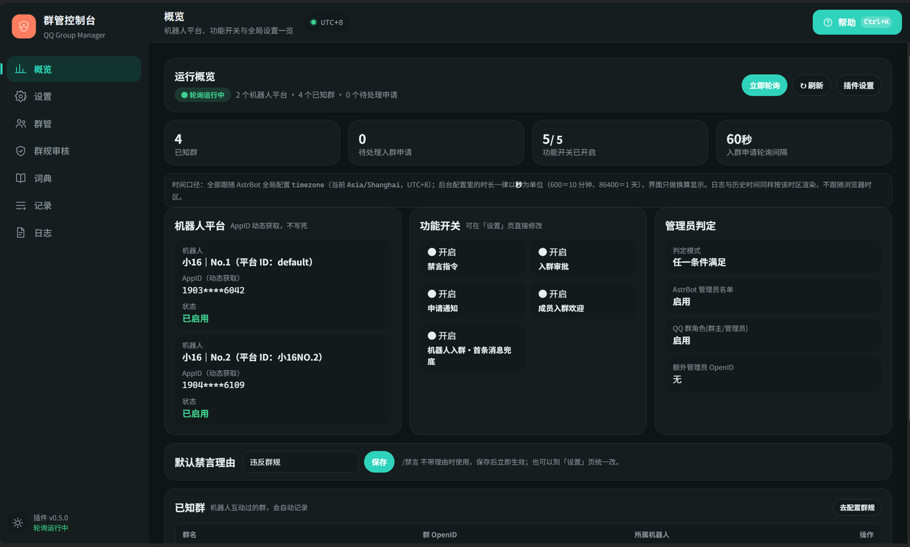
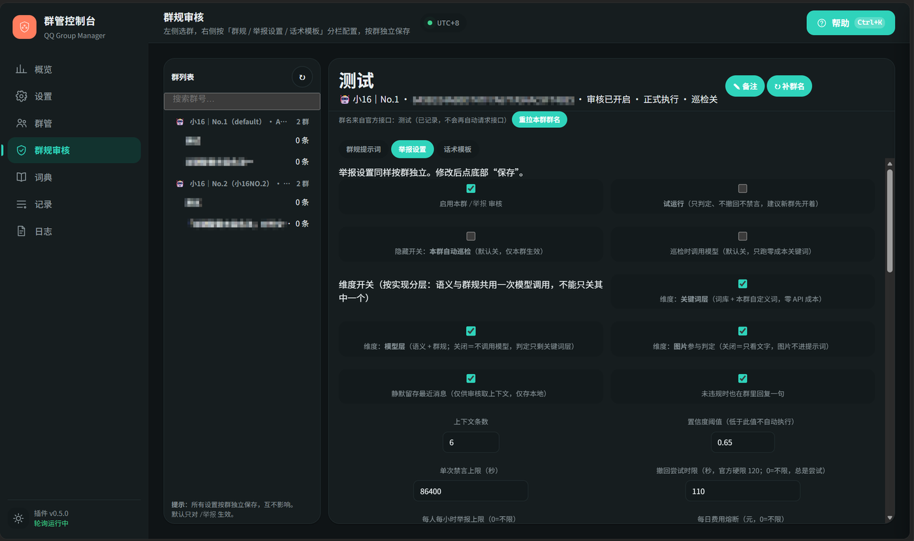
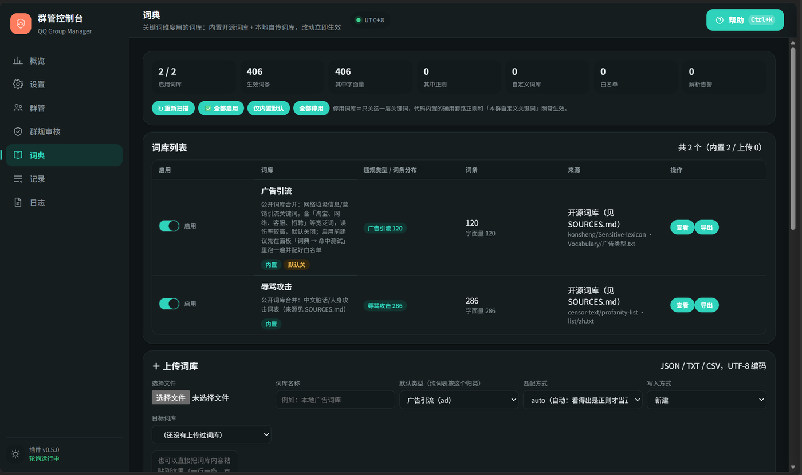

> 📖 **这是详细版手册**——完整配置项、指令边界、排障逻辑都在这里。
> 只想快速上手，看 [README](../README.md)；只想看改了什么，看 [CHANGELOG](../CHANGELOG.md)。

# QQ官机群管 · 完整手册（astrbot_plugin_qq_group_manager）


[](../LICENSE)
[](../CHANGELOG.md)
[](#快速开始)
[](#快速开始)
[](#安装与升级)
[](https://github.com/Canoe16type/astrbot_plugin_qq_group_manager/actions/workflows/ci.yml)

> **免责**
>
> - 内置词库是**审核用黑名单**，只在本机匹配拦截，不对外提供、不生成、不上传；面板与日志都不展示词条文本。
> - 词条由 `tools/build_lexicons.py` 从公开开源项目生成（见 [lexicons/SOURCES.md](../lexicons/SOURCES.md)），
>   上游社区维护，**可能误伤或漏词，作者不作保证**；是否启用由使用者自行判断并承担责任。
> - 本插件是辅助工具，不能替代平台审核义务与人工管理；使用须符合当地法律与平台规则。

基于 QQ 官方机器人平台（`qq_official`）的群管理插件：禁言、入群审批、欢迎语、消息撤回、群规审核，内置 WebUI 管理面板与实时日志。

| 项目 | 说明 |
| --- | --- |
| 支持平台 | `qq_official`（QQ 官方机器人平台） |
| 依赖 | AstrBot 4.16 ~ 4.x（实测 4.29.4）、QQ 官方机器人平台适配器 |
| 许可 | MIT License（见 [LICENSE](../LICENSE)） |

不修改 AstrBot 本体代码；AppID / AppSecret 从当前平台自动获取。
> **AI 生成声明**：本插件由 AI 生成，代码经人工审核与测试后发布。

---

## 目录

1. [快速开始](#快速开始)
2. [功能总览](#功能总览)
3. [界面预览](#界面预览)
4. [安装与升级](#安装与升级)
5. [权限说明](#权限说明)
6. [指令手册](#指令手册)
7. [成员档案（openid 认不出人怎么办）](#成员档案openid-认不出人怎么办)
8. [群规审核（`/群管 举报`）](#群规审核群管-举报)
9. [入群申请（事件 / 轮询 / 按钮审批）](#入群申请事件--轮询--按钮审批)
10. [机器人被移出群（数据自动回收）](#机器人被移出群数据自动回收)
11. [定时汇报（群管日报）](#定时汇报群管日报)
12. [入群自动审批（白名单号码自动通过）](#入群自动审批白名单号码自动通过)
13. [词典（关键词词库）](#词典关键词词库)
14. [插件配置说明](#插件配置说明)
15. [管理面板](#管理面板)
16. [常见问题（FAQ）](#常见问题faq)
17. [数据与日志位置](#数据与日志位置)
18. [用了哪些 AstrBot 接口](#用了哪些-astrbot-接口)
19. [版本记录](#版本记录)

---

## 快速开始

1. 把 `astrbot_plugin_qq_group_manager` 目录放进 AstrBot 的 `plugins/`（不要多套一层），重启或重载插件；
2. **群主**在手机 QQ → 群设置 → 机器人 → 把「机器人可获取的群聊消息范围」设为**获取群内全部消息**；
3. **群主**把机器人设为群管理员（否则无法撤回他人消息）；
4. 群里发 `/群管` 验证。

这四项决定功能上限，每个群要分别设置：

| 项目 | 要求 | 说明 |
| --- | --- | --- |
| 群聊消息范围 | 群主设为「获取群内全部消息」 | 未开启时机器人只收到 @ 它的消息，上下文判定与引用回溯不完整 |
| 事件订阅 | QQ 开放平台 → 开发 → 回调配置，勾选 `GROUP_MESSAGE_CREATE` | Webhook 模式必做，否则收不到全量群消息事件 |
| 机器人身份 | 设为群管理员 | 只决定能否撤回**普通成员**的消息；未设置时面板禁言列表会报 `11703`（[例图](screenshots/05-faq-11703.png)） |
| 撤回时限 | 官方硬限制：超过 **2 分钟**不可撤回（`40064004`） | 与管理员身份无关，管理员只扩大「能撤谁」 |

> 想验证实际权限：把「撤回尝试时限」填 `0`（不限，总是尝试），失败原因会写进审核记录。

---

## 功能总览

| 模块 | 能力 |
| --- | --- |
| 禁言管理 | `/群管 禁言`（多种时长写法 + 可选理由）+ 子命令 `禁言 解除` / `禁言 名单` / `禁言 历史`（可按成员 / OpenID 查）；旧写法 `/群管 解禁`、`/群管 查禁言`、`/群管 禁言历史` 仍可用（**1.6.0 移除**） |
| 消息撤回 | `/群管 撤回` 引用撤回或按消息 ID 撤回；原始消息本地留存 |
| 入群审批 | `/群管 审批` 查看、`/群管 审批 通过` `/群管 审批 拒绝` 操作，并轮询新申请在群内通知；面板可配**官方自动审批策略**，白名单号码申请入群自动通过（见 [入群自动审批](#入群自动审批白名单号码自动通过)） |
| 欢迎消息 | 审批通过后的欢迎语；机器人首次进群自我介绍（事件优先 + 首条消息兜底） |
| 成员档案 | `member_openid ↔ 昵称/备注` 对照表：按群消息自动攒人、指令或面板补名字，退群通知从中取名 |
| 成员退群通知 | 成员退群/被移出时在群里发一条通知（含 openid 短标识、在群天数、发言数），见 [成员档案](#成员档案openid-认不出人怎么办) |
| 群规审核 | `/群管 举报` 触发四维度判定，违规自动撤回 + 禁言；群规、开关按群独立配置 |
| 权限判定 | AstrBot 管理员 / QQ 群角色 / 自定义 OpenID，三种条件可组合 |
| 词典 | 关键词层：2 个最小内置词库（406 条）+ 上传自己的词库 + 白名单 + 命中测试 + 给自己地址拉词表 |
| WebUI | 配置分组编辑（多数即时生效）+ 管理面板九页签 |
| 零侵入 | 不修改 AstrBot 本体代码 |

---

## 界面预览

管理面板在 AstrBot 插件详情页打开，九个页签：**概览 / 设置 / 群管 / 入群审批 / 群规审核 / 成员档案 / 词典 / 记录 / 日志**。

| 概览 | 群规审核 | 词典 |
| --- | --- | --- |
|  |  |  |

<sub>截图使用示例群名与演示数据，不含任何真实群号 / openid。</sub>

---

## 安装与升级

> 🎯 本插件**只支持腾讯 QQ 官方机器人**（AstrBot 的 `qq_official` 平台适配器）。
> OneBot v11 / NapCat / Lagrange / go-cqhttp 等第三方协议端不支持，装上去不会工作。

**安装（两种方式，选一）**：

- **插件市场**：AstrBot WebUI → 插件 → 插件市场 → 搜索「QQ官机群管」→ 安装（自动处理版本与更新）；
- **手动**：把 `astrbot_plugin_qq_group_manager` 目录放进 `plugins/` → 重启或重载。

装完在 WebUI 插件设置按需修改，插件详情页打开管理面板。

**升级**：先备份旧插件目录与 `data/config/astrbot_plugin_qq_group_manager_config.json`，再覆盖。

---

## 权限说明

管理员判定条件可组合，组合方式由「判定模式」决定：

- **any（默认）**：满足任一启用条件即为管理员；
- **all**：所有启用条件都满足才算管理员。

可启用的条件：① **AstrBot 管理员**（WebUI 配置的管理员用户 ID）；② **QQ 群角色**（群主 / 管理员）；
③ **自定义 OpenID**（插件配置里填写的名单）。

> 只启用「QQ 群角色」时，AstrBot 管理员在群里不算管理员；只启用「AstrBot 管理员」时，群主也得配好 ID 才能用指令。

**生效群范围**：`basic.target_group_openids` 留空＝所有群生效；填写后只有这些群内的指令生效。
同一个群被多个机器人实例拉进去时，可以写成「`机器人实例ID:群OpenID`」只让指定机器人管（实例 ID 就是
AstrBot 平台设置里那个 id，例如 `qq_official_main:ABC123...`）；不带前缀的写法对所有机器人生效。

> **成员昵称接口有权限坑**：`GET /v2/groups/{gid}/members/{openid}` 需额外接口权限，多数应用返回
> `11253 应用无接口访问权限`。插件静默降级为显示 OpenID 或内存缓存，不影响禁言 / 撤回 / 审批
> （实测如此，面板里看到 OpenID 属正常现象）。

---

## 指令手册

所有指令统一收在指令组 `/群管` 下，写法是 `/群管 <子指令>`；AstrBot 面板里只会出现一条「群管」，展开即全部子指令。

**通用说明**：指令一律写成 `/群管 <子指令>`，参数空格分隔；不带 `/` 时**必须 @ 机器人**，否则当普通聊天。
**指令名与被 @ 的成员之间必须留一个空格**（`/群管 禁言 @某人 10分钟` ✅，`/群管 禁言<@某人>10分钟` ❌ 会被当成没带参数）。

**权限**：`/群管`、`/群管 帮助`、`/群管 举报`、`/群管 群规`（只读）全体可用；其余需管理员。

> 只发 `/群管` 会先回一句「参数不足」再列指令树——这是 AstrBot 对指令组的默认提示，不是报错。

**指令明细**

| 指令 | 写法 | 注意 |
| --- | --- | --- |
| `/群管 禁言` | `/群管 禁言 @用户 时长 [理由]`，如 `/群管 禁言 @小明 10分钟 刷屏` | 时长与理由顺序可互换；必须 @ 目标；不能禁言自己；同时 @ 多人只处理第一个；理由省略时用「默认禁言理由」 |
| `/群管 禁言 解除` | `/群管 禁言 解除 @用户`（旧写法 `/群管 解禁 @用户`，**1.6.0 移除**） | 可一次 @ 多人，逐个处理并分别回复 |
| `/群管 禁言 名单` | `/群管 禁言 名单`（旧写法 `/群管 查禁言`，**1.6.0 移除**） | 数据来自插件本地缓存 |
| `/群管 禁言 历史` | `/群管 禁言 历史 [条数\|汇总] [@用户\|OpenID前缀]`（旧写法 `/群管 禁言历史 …`，**1.6.0 移除**） | 默认最近 10 条（范围 1~50）；`汇总` 按成员统计；支持 OpenID 前 8 位以上前缀，适合查已退群用户。QQ 不提供历史查询，记录为插件本地保存 |
| `/群管 撤回` | 引用消息后 `/群管 撤回`；或 `/群管 撤回 <message_id>` | 超 2 分钟不可撤回（`40064004`）；非管理员只能撤自己的（`40062003`）；撤回记录写入 `recall_history.json`，引用撤回会留存原文，按 ID 撤回只有 ID |
| `/群管 审批` | `/群管 审批 [页码\|全部 [页码]]` | 列出待处理申请（序号、昵称、来源、时间、验证消息），缓存为空时自动拉取。默认本群每页 10 条，序号全局连续；`全部` 按群汇总所有已知群，`全部 2` 翻第 2 页。申请通知里带按钮时可直接点按钮处理，不必用指令 |
| `/群管 审批 通过` | `/群管 审批 通过 序号\|昵称关键字`（旧写法 `/群管 通过 …`，**1.6.0 移除**） | 匹配列表中第一个包含该关键字的申请；开启欢迎时自动发欢迎语 |
| `/群管 审批 拒绝` | `/群管 审批 拒绝 序号\|昵称关键字 [理由]`（旧写法 `/群管 拒绝 …`，**1.6.0 移除**） | 理由会透传给官方接口 |
| `/群管 状态` | `/群管 状态`（旧写法 `/群管 汇报`，**1.6.0 移除**） | 立刻返回群管日报（待处理申请数 + 名单 + 当前禁言人数），被动回复、不吃主动消息频控 |
| `/群管 状态 群` | `/群管 状态 群 [清理]`（旧写法 `/群管 体检 [清理]`，**1.6.0 移除**） | 逐个查已记录的群，确认机器人还在不在（`bot_state`）。默认只报告，加 `清理` 才删离群群的数据；一次最多 20 个群，`11253` 的群显示「无法确认」且不动数据。详见 [机器人被移出群](#机器人被移出群数据自动回收) |
| `/群管 状态 自检` | `/群管 状态 自检`（旧写法 `/群管 自检`，**1.6.0 移除**） | 一条命令看清审核链路：适配器、开关与执行模式、三层（关键词/模型/图片）、审核模型、今日调用/预算、缓存命中率、并发排队与超时、最近一次模型调用结果。**不主动探活**（探活是真花钱），细节看 DEBUG 日志的 `[模型]` 行 |
| `/群管 状态 群名` | `/群管 状态 群名`（旧写法 `/群管 群名`，**1.6.0 移除**） | 调群信息接口并入库，面板群列表优先显示（手动备注 > 接口群名）。打开面板**不会**自动请求；接口仅对白名单机器人开放，返回 `11253` 时用面板「✎ 备注」手动起名 |
| `/群管 群规` | 见下 | 命令行添加的群规固定为「其他违规 / 中」；要精确设置类型与严重度请用面板 |
| `/群管 审核` | 见下 | 诊断入口，不受维度开关限制 |

### 指令对照表与弃用计划

功能相近的独立指令在 1.5.0 收进 5 个大类——`禁言`（解除 / 名单 / 历史）、`审批`（列表 / 通过 / 拒绝）、
`状态`（日报 / 群 / 自检 / 群名）、`审核`、`群规`。**新旧写法目前并存，但走向已经定死：**

| 版本 | 旧写法 | 新写法 |
| --- | --- | --- |
| 1.5.0（当前） | 可用，做别名 | 推荐，文档统一用它 |
| 1.6.0（下个版本） | **移除**，敲了不生效 | 唯一写法 |

| 旧写法（1.6.0 移除） | 新写法（推荐，1.5.0 起） |
| --- | --- |
| `/群管 解禁 @用户` | `/群管 禁言 解除 @用户` |
| `/群管 查禁言` | `/群管 禁言 名单` |
| `/群管 禁言历史 [汇总] [@用户]` | `/群管 禁言 历史 [汇总] [@用户]` |
| `/群管 通过 N` | `/群管 审批 通过 N` |
| `/群管 拒绝 N [理由]` | `/群管 审批 拒绝 N [理由]` |
| `/群管 汇报` | `/群管 状态` |
| `/群管 体检 [清理]` | `/群管 状态 群 [清理]` |
| `/群管 自检` | `/群管 状态 自检` |
| `/群管 群名` | `/群管 状态 群名` |

插件面板的指令树里只会看到大类，旧名字挂在对应大类下（AstrBot 指令组 alias）；
1.6.0 会把 alias、`_LEGACY_ALIASES` 映射表和「首 token 白名单」里的旧名字一起删掉。
**现在就该换成新写法**——本文档所有示例、面板帮助中心、插件内 `/群管 帮助` 都已是新写法。

`/群管 群规` 子命令：

| 用法 | 说明 |
| --- | --- |
| `/群管 群规` 或 `/群管 群规 列表` | 列出本群群规（序号、名称、说明、类型、时长） |
| `/群管 群规 添加 刷屏 \| 连续刷无意义内容 \| 10分钟` | 添加一条（**竖线 **`\|`** 或全角 **`｜`** 都行，也支持纯空格分开；时长省略默认 1 小时**） |
| `/群管 群规 设置 刷屏 \| 说明 \| 10分钟 ; 广告 \| 说明 \| 1小时` | 批量追加（`;` 或换行分隔，写法同上） |
| `/群管 群规 删除 序号\|id`；`/群管 群规 清空` | 删除一条 / 清空本群 |

`/群管 审核` 子命令：

| 用法 | 说明 |
| --- | --- |
| `/群管 审核` | 查看本群状态：开关、试运行、巡检、群规条数、阈值、上限、累计次数、缓存命中率 |
| `/群管 审核 试跑 开\|关` | 切换试运行（只判定不执行） |
| `/群管 审核 巡检 开\|关` | 切换本群关键词巡检（零成本，仅关键词层；开了变体检测时变体层一并生效） |
| `/群管 审核 测试 <内容>` | 用当前配置试判一条内容，输出判定与拟执行动作 |

> **记录页（面板）**：判定记录现在保留原文前 1000 字，点「原文」列可看完整判定详情并复制；
> 「⭳ 导出 CSV」把当前群的记录（含原文、人工标注）导成表格。人工标注「误判 / 正确」会存进判定记录，
> 并在插件启动时重建进提示词示例——重启不再丢。
> **快捷跳转**：群规审核页头「✎ 备注 / ↻ 补群名」右侧有 **📋 判定记录**，一键切到本群判定留痕；
> 反过来，判定记录里的「切换群 →」会跳回群规审核选群——两边对称，改完规则能立刻看效果。
| `/群管 审核 自我介绍` | 手动重发群管功能介绍（用于测文案；成功后本群不再触发旧的首条消息欢迎） |

`/群管 管理登记`（审核提醒名单）：

| 写法 | 作用 |
| --- | --- |
| `/群管 管理登记` | 把自己登记进本群名单（回执带当前人数） |
| `/群管 管理登记 列表` | 查看已登记的人（`查看` / `list` 同义） |
| `/群管 管理登记 取消` | 把自己移出（`移除` / `注销` / `off` 同义） |

为什么是「主动登记」而不是自动识别：QQ 官方群消息里 `author` 只有 `member_openid`，拿不到稳定角色字段，
而「谁在线、谁愿意兜底」本来就是群自己的事。变体累计提醒**只 @ 名单内的人**，一个群没人登记就不发提醒，
不刷群、不耗主动消息配额。本群若关了「变体累计提醒」，登记仍成功，但会提示暂时收不到 @。
面板「群规审核 → 举报设置 → 变体提醒名单」也能看和移除。

---

### 成员档案（`/群管 成员`）

官方给的每个身份标识只有一个 `member_openid`（形如 `C3D4E5F6…`），既没有昵称也没有 QQ 号，
所以「退群的是谁」在插件侧必须先有一张**可以人工维护的对照表**。

| 写法 | 作用 |
| --- | --- |
| `/群管 成员` | 看本群档案，按最近发言排序（每页 15 条） |
| `/群管 成员 已退` / `在群` / `无名` / `全部` | 按状态筛（`退群` / `未命名` / `named` 同义） |
| `/群管 成员 2` | 第 2 页 |
| `/群管 成员 查 小明` | 搜昵称 / 备注 / openid 片段 |
| `/群管 成员 改名 3 小明` | 给第 3 条命名（也可以直接给 openid 或 openid 尾段） |
| `/群管 成员 备注 3 老群友` | 加备注（留空即清除） |
| `/群管 成员 删除 3` | 删掉单条档案 |
| `/群管 成员 清理` | 清掉所有「已退群」记录 |
| `/群管 成员 拉取` | 调官方「群成员列表」接口补昵称（当前是内邀能力，多半返回 11253） |

网页面板「**成员档案**」页签是同一份数据：分页表格、点按钮改昵称/备注、批量导入（`openid,昵称,备注` 一行一条）、
一键清理已退群。

> 昵称来源优先级：**人工（`manual`）> 官方接口（`api`）> 消息里带的（`msg`，通常是空的）**。
> 人工改过的名字不会被后续接口回填覆盖。

---

## 成员档案（openid 认不出人怎么办）

> 一句话：**官方只给 `member_openid`，插件就把 openid 当主键，攒一张能人工补名字的表**，
> 退群通知、禁言列表、审核提醒都从这张表取名字。

### 为什么必须有这张表

| 数据源 | 能拿到什么 | 拿不到什么 |
| --- | --- | --- |
| 群消息事件（`GROUP_AT_MESSAGE_CREATE` 等） | `member_openid`、消息内容、时间戳 | 昵称、QQ 号、群昵称 |
| 群成员事件（`GROUP_MEMBER_ADD` / `GROUP_MEMBER_REMOVE`） | `timestamp`、`group_openid`、`member_openid`、`user_openid`（可能为空） | 昵称、事件 id |
| 群成员信息接口（`GET /v2/groups/{g}/members/{o}`） | 理论上含 `username` 昵称 | **目前是内邀白名单能力，普通机器人返回 `11253`** |
| 群成员列表接口（`GET /v2/groups/{g}/members`） | 同上，可翻页 | 同上，`11253` |

所以「退群了却叫不出名字」不是插件没做，是平台当前就不给。档案表把这件事变成**可以人工补齐**：
机器人每收到一条群消息就记一笔（谁、什么时候、说了几句），名字由你补一次，之后一直有效。

### 档案怎么攒起来的

1. **入群事件**（`GROUP_MEMBER_ADD`）：建一条记录，记下 `first_seen`，退群时的「在群 X 天」就靠它；
2. **群消息**：更新 `last_seen` 与 `msg_count`（高频，60 秒最多落盘一次）；
3. **人工**：指令 `/群管 成员 改名` 或面板「成员档案」页签；
4. **官方接口**：将来拿到白名单权限后，`/群管 成员 拉取` 或面板「⬇ 官方同步」一键回填（不覆盖人工昵称）；
5. **跨群借名**：事件里如果带了 `user_openid`（同一机器人下跨群稳定），本群档案没名字时会去别的群
   找已经补过的名字借过来，`name_source` 记为 `cross`（面板显示「借名」）；
6. **退群事件**：按 `openid` 找到档案 → 标 `left` + 记 `left_at`；**档案里没有这个人也会补一条**
   （只有 openid、无名），方便事后按 openid 追溯。

### 退群通知是怎么发出去的

- 事件订阅靠插件内置的运行时注入（`member_event.py` 往 `qq_official` 适配器的 botpy client 上挂
  `on_group_member_add` / `on_group_member_remove`），所以开启后需要重启 AstrBot 或等适配器自动重连一次；
- 通知文案模板 `templates.msg_member_remove_notify`，默认 `👋 {username}（{short}）离开了本群{extra}`；
- **只能用主动消息**，这一点文档写得很清楚，两重限制：
  1. `GROUP_MEMBER_REMOVE` 的事件体只有 `timestamp / group_openid / member_openid / user_openid`，
     **连事件 id 都没有**（`event_id` 要求「从事件最外层的 `id` 获取」，这里没有）；
  2. 发送群消息接口的 `event_id` 只支持 `INTERACTION_CREATE` / `GROUP_ADD_ROBOT` / `GROUP_MSG_RECEIVE`，
     其它事件拿 `event_id` 去回复会返回 `40034027`（该事件不支持回复消息）。

  所以默认 `active`；`passive_first` 是留给将来的兼容开关：真有 `event_id` 就先试被动回复，
  失败自动降级为主动消息，通知不会丢。主动消息受频控（超限 40034100），群特别多时注意配额。

### 局限（提前说清楚，免得踩坑）

- 档案是**按群隔离**的：同一个人的 `openid` 在同一个机器人下是稳定的，但不同机器人的 openid 不同；
- 名字只能人工补：官方没有可用的昵称来源，机器人也不会去猜；
- 「在群 X 天」从**第一次被记录**算起（入群事件没收到时就是第一次发言），不是真实入群时间；
- 数据只存在本机 `data/plugin_data/astrbot_plugin_qq_group_manager/members.json`，不上传任何地方。

---

## 群规审核（`/群管 举报`）

> **核心约定：只有收到 `/群管 举报` 才进入审核**。平时不扫描、不判定、不发言；群内发言均为被动回复。

1. 群成员长按违规消息 → 「回复」引用它 → 发送 `/群管 举报`（可附一句说明）；
2. 违规则撤回（限 2 分钟内）+ 禁言，并回一句带判定依据的话术；
3. 结果在面板「记录 → 判定记录 / 试跑」可查，误判可一键标记；每条记录落**类型 + 严重度 + 置信度**。

### 四维度判定

| 维度 | 话术说法 | 触发条件 | 成本 |
| --- | --- | --- | --- |
| 关键词 | 根据**关键词** | 命中自定义关键词 / 本地词库 / 代码内置套路正则 | 零成本 |
| 群规 | 根据**群规** | 命中本群某条规则 | 无额外成本 |
| 语义分析 | 根据**语义分析** | 结合上下文判断（人身攻击、阴阳怪气等） | 调模型 |
| 图片识别 | 根据**图片识别** | 被举报消息含图片 | 调多模态模型 |

### 禁言时长怎么算

**模型无权指定秒数**，只输出类型与严重度，时长由代码计算：

| 情况 | 时长 |
| --- | --- |
| 命中某条群规 | 取该规则配置的时长 |
| 未命中群规 | 按严重度：低 10 分钟 / 中 1 小时 / 高 1 天 |
| 兜底 | 低于 60 秒时用「兜底禁言时长」（默认 600 秒） |
| 上限 | `max_mute_seconds`（默认 1 天），超出截断 |

### 群规怎么写

面板「群规审核 → 群规提示词」添加，一条群规包含：**规则名**（会出现在判定依据里）、
**判定说明**（写进提示词，写清「算什么」和「不算什么」能显著减少误判）、**时长**（`10分钟` / `2小时` / `1天`）、
**类型**（广告引流 / 人身攻击 / 色情低俗 / 违法违规 / 刷屏灌水 / 其他违规）、
**严重度**（低 / 中 / 高，仅在未命中具体规则时用于算时长）。

> 每个违规类型建议只配一条：同类多条时，模型若只回类别，会退化成按严重度匹配。

### 开关与默认值（按群独立）

面板「群规审核 → 举报设置」。开关都按群生效，改完立即影响下一次判定。

| 设置 | 默认 | 说明 |
| --- | --- | --- |
| 启用举报审核 | 开 | 关掉后本群 `/群管 举报` 不处理 |
| 试运行 | 开 | 只判定并回话术，不撤回不执行 |
| 置信度阈值 | 0.75 | 模型自评低于此值只记录、不执行 |
| 禁言上限 | 1 天 | 超出截断 |
| 举报频控 | 每人每小时 5 次 | — |
| 撤回尝试时限 | 110 秒 | `0`＝不限，总是尝试 |
| 豁免名单 | 空 | 名单内成员与群管理员不做处理 |
| 自定义关键词 | 空 | 额外正则，与词库合并判定 |
| 维度：关键词 / 模型 / 图片 | 全开 | 关模型层＝不发起任何模型请求；关图片＝图片不进提示词（纯图片举报直接判「无法判定」） |
| 本群自动巡检（隐藏项） | 关 | 仅关键词层；需 AI 巡检再开「巡检时调用模型」，受每日费用熔断约束 |
| 变体检测 | 关 | 见下节；「疑似即撤回」也默认关；形近字开、模糊音节关、最小字数 3 |
| 待办队列 | 开 | 低置信未处理 + 变体疑似自动进面板待办 |
| 复犯累进 | 关 | 窗口 30 天、倍率每次翻倍、上限 4 倍 |

### 变体检测（「袋刷单」「加·微·信」这类绕过）

词表和正则很好绕，所以另开一层，针对三种常见写法：

| 绕过写法 | 例子 | 处理 |
| --- | --- | --- |
| 插符号 / 空格 / 全角 | `加·微·信`、`微 信`、`１００` | 归一化（去符号、全角转半角、小写）后按同一套规则匹配 |
| 谐音同音字 | `袋刷单`、`薇信` | 转拼音音节序列再比对 |
| 形近字 | `未端`、`己经` | 字形近似度比对（内置 78 组常见形近字） |

**只产出「疑似」信号：命中只撤回 + 记录 + 进待办，永不自动禁言。** 谐音 / 形近的误报天然高于词表，
而禁言是惩罚性动作，必须由人确认——误报的代价只是多看一眼。

调参取舍：谐音最小字数默认 3（44 条正常群聊句子实测，3 字起误报 0%，放宽到 2 字 + 模糊匹配约 25%）；
「允许 1 个音节差异」默认关（误报主要来源）。生效入口四条互不影响：`/群管 举报`、本群巡检、`/群管 审核 测试`、面板试跑。

成本：纯离线计算，不调模型；索引随词库重建（约 5700 条拼音词条约 90ms），单条消息约 0.4ms。
命中词条不写入日志与记录，只在记录里标「变体」类型。

**已知短板**（`tools/bench_evasion.py` 实测召回）：插符号 / 插空格 / 插 emoji / 同音字 / 全拼 100%，
拼音首字母 98%，形近字替换 56%，**「词中间插字」只有 13%**（`代X刷单` 会打断连续音节窗口）。
补它需滑窗 + 编辑距离，误报与耗时都会涨，暂不做——插字绕过主要靠「自定义关键词 + 词库字面量」兜底。

### 待办队列与复犯累进

**待办队列**（默认开）：两类记录自动进「记录 → 判定记录 / 试跑 → 待办」——① 模型判违规但置信度低于阈值、
没执行；② 变体疑似（不论是否撤回）。每条可点 **撤回 / 禁言 / 忽略**，前两个是真动作，会写进禁言历史与撤回历史。
队列只摆近 7 天记录：更早的已超撤回时限，摆上来也没用，顺便挡住「升级后老账一次性涌进队列」。

> 边界说明：这是**自助队列，不是值守审核台**。插件不推送待办，得管理员自己看面板。关掉开关后新记录不再进队列，
> 但记录本身照常留痕。

**复犯累进**（默认关）：`本次时长 = 基础时长 × min(1 + 前科次数 × 倍率, 倍率上限)`，默认 30 天窗口、
每次翻倍、上限 4 倍，最终仍受单次上限截断。只认真正执行过的记录（试运行、标误判、已删除都不算前科）。
它会改变实际处罚力度，建议先开试运行、翻几天记录再开。

### 维度开关与省钱

四个维度在面板上分开显示，但**实现只有三层**：

| 开关 | 覆盖 | 关掉之后 |
| --- | --- | --- |
| 关键词层 | keyword | 不再查词库与自定义词 |
| 模型层 | rule + semantic | 彻底不发模型请求，判定只剩关键词层 |
| 图片 | vision | 图片不进提示词，只送文字 |

**为什么不能只关「语义」留「群规」**：群规是注入同一次模型调用的提示词，模型在一趟输出里同时给出
「是否符合某条群规」和「是否语义违规」。拆成两次调用要付两倍 token 与延迟，还会让结论互相矛盾。

省钱的三种情况：纯词表群（关模型层，违禁类词表几十万条也是毫秒级零费用）；群里几乎不发言（试运行几天，
记录全是「不违规」就关模型层）；怕图片跑偏或想控成本（关图片层，文字照判）。
模型层关闭时有人举报，群里会明确回「本群已关闭模型判定（仅关键词层）」，把「没判」和「判了不违规」分开。

### 机器人入群自我介绍

优先走官方 `GROUP_ADD_ROBOT` 事件，**入群瞬间**就能拿到 `group_openid`：

| 环节 | 做法 |
| --- | --- |
| 登记 | 入群那一刻写进 `known_groups`，不做静默轮询；顺手拉一次群名，失败不重试（面板可手动补） |
| 发消息 | 用事件 `event_id` 走**被动消息**——机器人刚进群时没人 @ 过它，主动消息大概率报 `11251` |
| 撤销 | 发送成功后本群标记「已介绍」，旧的「首条消息欢迎」自动撤销 |
| 兜底 | 发送失败或事件没收到（重启丢事件、装到已有群），由「首条消息欢迎」补一次 |

两个开关互不干扰：`基本设置 → 机器人入群自我介绍`（事件路径）与 `机器人入群·首条消息兜底`，均默认开。
文案在 `设置 → 模板` 改，支持 `{bot_name}`、`{group_name}`，兜底留空即复用自我介绍；单测文案用 `/群管 审核 自我介绍`
（先 @ 一下机器人，避免 11251）。删掉 `data/plugin_data/astrbot_plugin_qq_group_manager/group_intro_state.json` 可重新触发。

### 置信度是怎么来的

**置信度不是插件算的**，是模型在返回 JSON 里自填的 `confidence`（0~1）。插件只拿它和阈值比：
`≥ 阈值` 正常执行；`< 阈值` 只写记录（动作列写明 `置信度 0.72 < 阈值 0.75`）。
它反映模型的自评信心，**不同模型的数值不可横向比较**。

关键词层不受阈值影响：命中词库 / 正则直接记 `1.0`，必然执行、不调模型。所以看到「判定把握不足」时，
一定是走了语义 / 多模态维度（或引用消息没定位到）。人身攻击也常见 0.7 出头——模型自评保守、
语义维度难给高分、提示词偏「宁可漏判」三者叠加的结果。

| 调法 | 说明 |
| --- | --- |
| 调低阈值 | 改到 `0.65`~`0.7`，先保持试运行看几天记录 |
| 写明确的群规 | 命中 `rule` 维度比 `semantic` 稳得多 |
| 保留上下文 | `keep_context`，内存中最多 200 条 / 10 分钟 |
| 先试跑 | 面板试跑直接看到分数与理由 |

> 缓存：判定结果保留 7 天，命中缓存即跳过阈值检查。**只有过了阈值的判定（或试运行判定）才入缓存**，
> 所以同一句话结果一致；缓存存内存，重启即清空。

### 模型选择

在插件配置「群规审核」分组里选审核模型与多模态模型；**留空＝用当前会话的对话模型**。
文本与群规放在 system 前缀中，缓存友好、省 token。

---

## 入群申请（事件 / 轮询 / 按钮审批）

这一章讲「有人申请进群」这件事在插件里从头到尾怎么走。1.4.0 起它有两套获取通道
（**事件为主、轮询为辅**）和两种处理方式（**指令、消息按钮**），先看一遍链路，后面排障就知道卡在哪一环。

### 一条申请的全链路

```
用户提交入群申请
   │
   ├─(推送) GROUP_JOIN_REQUEST ──► member_event 注入的 parser
   │                                   │
   └─(拉取) GET join_request_list ─────┤（兜底，默认 5 分钟一次）
                                       ▼
                        _on_group_join_request / _poll_group
                                       ▼
                           并入本地待审批缓存 _pending
                       （去重键 = 申请人 openid + 申请时间）
                                       ▼
                     合并窗口 2 秒（同批申请并成一条通知）
                                       ▼
                        _notify_join_requests（唯一出口）
                 去重（同一申请 10 分钟只推一次）→ 渲染模板
                       → 组装按钮 → 主动消息发出
                                       ▼
              管理员点「通过 / 拒绝」──► INTERACTION_CREATE
                                       ▼
              AstrBot 适配器：先 PUT 回应 code=0，再转成普通事件
                                       ▼
                插件认领 → 权限复核 → 拿本地缓存核对申请
                                       ▼
             _apply_join_decision（指令与按钮共用）→ 调官方接口
                                       ▼
              被动消息回执（event_id = 互动事件 id）+ 通过后发欢迎语
```

三个关键点先说清楚，后面都好理解：

1. **推送比轮询快，但不是所有环境都有推送**：平台只在机器人是群管理员时才推
   `GROUP_JOIN_REQUEST`，所以轮询不能删，只降频当兜底。
2. **拉取到的每条申请 `join_request_id` 每次都不一样**（官方接口实测行为），
   所以去重键用「申请人 openid + 申请时间（`apply_at`）」，`join_request_id` 只在
   真正调审批接口时现取现用。
3. **申请通知只能发主动消息**：`event_id` 被动回复白名单只有 `INTERACTION_CREATE`、
   `GROUP_ADD_ROBOT`、`GROUP_MSG_RECEIVE` 三个，`GROUP_JOIN_REQUEST` 不在里面，
   拿它的事件 id 去回会直接 `40034027`。

### `GROUP_JOIN_REQUEST` 事件体

| 字段 | 说明 |
| --- | --- |
| `timestamp` | 事件时间 |
| `group_openid` | 群 openid |
| `member_openid` | 申请人 openid |
| `username` | 申请人昵称（**比轮询结果全**，轮询偶尔给空） |
| `apply_at` | 申请时间，去重键的一半 |
| `join_request_id` | 本次申请的 id，仅用于调审批接口 |
| `apply_source` | 来源（搜索 / 群号 / 邀请等） |
| `invited_by` | 邀请人 openid（邀请入群时才有） |
| `verify_info` | 验证信息（问题 + 回答 / 备注） |
| `risk_tips` | 平台风控提示 |
| `auto_approved` | 命中官方自动审批策略时才有，形如 `{"strategy_id": "xxx"}` |

插件拿到事件后做三件事：写进待审批缓存（同键用事件体覆盖轮询结果，昵称以事件为准）、
记一条事件统计（面板「概览」可见）、进合并队列。

### 两种获取模式怎么选

| `join_event_mode` | 行为 | 轮询间隔 | 适合谁 |
| --- | --- | --- | --- |
| `event_first`（默认） | 事件即时推送 + 低频轮询补漏 | `poll_interval_fallback`，默认 300 秒（下限 60） | 绝大多数部署 |
| `interval` | 纯轮询，1.4.0 之前的行为 | `poll_interval`，默认 30 秒（下限 10） | 确认收不到事件、只想靠轮询 |
| `off` | 只收事件，完全不轮询 | 不轮询 | 接口频控紧张；申请仍可用 `/群管 审批` 手动拉 |

两种通道**共用同一张通知去重表**，所以即便事件和轮询同时抓到同一条申请，也只会推一次。
申请被处理后，去重键会一起清掉，不会「处理完还反复提示」。

### 按钮是怎么工作的

申请通知消息下方挂一行「通过 | 拒绝」，点一下直接审批：

| 设计点 | 做法 | 为什么 |
| --- | --- | --- |
| 按钮类型 | `action.type=1`（回调），带 `data` | 回调把点击送回机器人，不占用户消息 |
| `data` 内容 | `qgm:ja:1:` + base64(申请 openid / 动作 / 申请时间) | 只放「意图」和定位键，不放权限位 |
| 真值来源 | 一律回查插件本地待审批缓存 | 按钮 `data` 是客户端输入，**不可信** |
| 互斥 | 同一申请的两个按钮共用 `group_id` | 官方内联键盘按 `group_id` 分组，点完一个另一个变灰 |
| 按钮 `id` | `qgm_a0` / `qgm_d0`（带行号） | 官方要求同条消息内 `id` 唯一 |
| 行数上限 | 每条通知最多 3 个申请，硬上限 5 行 × 5 键 | 超限会 `40034029`，插件自动截断并提示用指令 |
| 点击回执 | `event_id = 互动事件 id` 的被动消息 | 官方把 `INTERACTION_CREATE` 列在 `event_id` 白名单里，不吃主动消息频控 |

**关于「谁点了回应」**：AstrBot 的 qqofficial 适配器收到点击时，**已经**替你
`PUT /interactions/{id}` 回了 `code=0`（客户端停止转圈）。官方规定同一个 `interaction_id`
只能回应一次，所以插件**不会**再重复回应，处理结果一律用消息回执告诉操作者。
换句话说：如果你在群里点了按钮却「只有转圈没有结果」，那不是回应没发出去，
而是回消息这步失败了（主动消息被限 / 群不在范围里），看日志里的 `[按钮]` 行。

### 谁能点这个按钮

两道闸，按顺序过：

1. **平台闸**：`button_permission=admin`（默认）时，官方 `permission.type=1` 只让群主 /
   管理员点得动按钮，普通成员点不动。
2. **插件闸**：`_button_operator_allowed`
   - 操作者在「权限判定 → 额外管理员 OpenID」（`admin_openids`）里 → 直接放行；
   - 否则只有 `button_permission=admin` 才放行（此时信任平台的第一道闸，因为官方群消息
     里拿不到 `member_role`，插件无法自己验群角色）；
   - `button_permission=everyone` 时**必须**名单命中，名单外的人点了只会收到
     「你没有处理入群申请的权限」。

反过来，如果你把 `admin_openids` 配了人，但那个人不是 QQ 群管理员，他把
`button_permission` 设成 `admin` 时**点不到按钮**（客户端先挡住了）——这种情况要么给他
群管理员，要么把 `button_permission` 改成 `everyone` 让插件来判。

### 失败矩阵（遇到问题先对这张表）

| 现象 | 原因 | 插件行为 |
| --- | --- | --- |
| 收不到申请事件，轮询也报 `11703` | 机器人不是群管理员 | 轮询退避 30 分钟、日志只提示一次；设成管理员后自动恢复 |
| 事件一条都没有，轮询正常 | 注入后没重连 / 平台不推 | `event_first` 下轮询照常兜底；日志有 `[成员事件] 收到 GROUP_JOIN_REQUEST` 才算通 |
| 通知发不出去（`11251`） | 群内主动消息受限或频控 | 记 warn 并提示可用 `/群管 审批`；不写去重时间，下次仍会重试 |
| 消息到了但没按钮 | AstrBot 版本不支持按钮事件 | 启动日志提示「按钮自动禁用，退回纯文本通知」；升级 AstrBot 即可 |
| 点了按钮提示「已处理或已失效」 | 别人先处理了 / 自动审批策略已放行 | 正常保护，不重复调接口 |
| 接口报 `40034029` | 内联键盘行列超限 | 自动截断/去掉键盘重发，保住正文 |
| 接口报 `40011021` | markdown 消息里按钮的 `group_id` 不合法（含冒号、过长） | 自动去掉 `group_id` 重发，**按钮保留**（只是点了不会同组变灰） |
| `msg_join_request_notify` 被清空 | 模板为空 | 不发送空消息，只记 debug 日志；恢复模板即可 |

### 排障顺序

1. 面板概览看「申请获取方式」和顶部徽标：`event_first` 下徽标应显示「事件 + 轮询兜底」。
2. `/status` 的 `approval` 段看 `join_event.groups_seen`：一直是 0 → 事件没通（多半不是管理员）；
   有增长 → 事件通道正常，问题在通知或按钮。
3. 看日志关键词：`[入群申请]`（事件/轮询/推送）、`[审批]`（执行）、`[按钮]`（点击与回执）、
   `[成员事件]`（注入层是否收到事件）。
4. 通知始终发不出去时，先确认群里能收到机器人别的主动消息（比如欢迎语），
   排除「主动消息被关 / 频控」这一层。

---

## 机器人被移出群（数据自动回收）

官方接口 `GROUP_DEL_ROBOT`（机器人被移出群聊）会带 `group_openid`，插件据此把该群的数据整块删掉。
目的是别让面板里堆一堆「已经不在的群」：群都没了，成员档案、群规、判定记录、禁言历史都没意义了。

### 事件是怎么接上的

| 项目 | 说明 |
| --- | --- |
| 事件名 | `GROUP_DEL_ROBOT`，事件体：`group_openid` / `op_member_openid` / `timestamp` |
| Intent | `GROUP_AND_C2C_EVENT`（`1<<25`），**与群 @ 消息同一位**，本来就在订阅 |
| parser | botpy 自带 `ConnectionState.parse_group_del_robot`，不用自己写 |
| 注入方式 | `member_event.py` 里给 client 挂一个 `on_group_del_robot`（和 `GROUP_ADD_ROBOT` 同一处），不改 AstrBot / botpy 任何文件 |

所以：**不需要开「群成员事件」那种受控重连**，只要 `enable_group_c2c` 开着就能收到。

### `bot_state` 二次确认

收到事件后，插件会先调 `GET /v2/groups/{group_openid}/bot_state`（30 QPM）复核一次：

| `bot_state` 结果 | 判定 | 动作 |
| --- | --- | --- |
| 正常返回（`member_role` / `joined_at` / `allow_proactive_msg`） | `in` | **不清理**。视为误推事件或已被重新拉回，只记一条 WARNING |
| `404` / 「群不存在」等明确报错 | `absent` | 清理 |
| `11293`（鉴权失败，**机器人非群成员**，HTTP 400） | `absent` | 清理。这是平台表达「不在这个群」的方式，用的是 400 而不是 404，别被「鉴权失败」四个字骗了——它说的是机器人不在群里，不是没权限 |
| `11253`（应用无接口访问权限） | `unknown` | **照样清理**（以事件为准）。该接口文档标注「仅白名单机器人可用」，没有权限是常态，不能当成「不在群」 |
| 网络错误 / 频控 / 其他 4xx | `unknown` | 照样清理（同上） |

一句话：**`unknown` 绝不等同于「离群」，但在「事件已经明确说被移出」的前提下，事件优先级更高。**
所以普通机器人（拿不到 `11253` 白名单）也能正常用这个功能——只是复核那一步会记一条「无法确认」。

### 清掉哪些数据

| 数据 | 位置 |
| --- | --- |
| 已知群列表 | `known_groups.json` |
| 群管自我介绍状态（已发 / 待兜底） | `group_intro_state.json` |
| 禁言历史 / 撤回历史 | `mute_history.json` / `recall_history.json` |
| 成员档案（含人工昵称、备注、退群记录） | `members.json` |
| 群规 / 审核设置 / 判定记录 / 群名备注 / 提醒名单 / 群话术覆盖 | `mod_*.json` |
| 入群欢迎去重、昵称缓存、申请缓存、待推送通知任务 | 内存 |

**只删本群**：其他群的同名结构一条不动（单测 `test_purge_removes_only_that_group` 锁定）。

### 手动巡检：`/群管 状态 群`（旧写法 `/群管 体检`，1.6.0 移除）

事件可能收不到（重启丢事件、平台没推、插件刚装）。这时用：

```
/群管 状态 群          # 只报告：✅ 在群 / ❌ 离群 / ⚠️ 无法确认
/群管 状态 群 清理     # 检出离群的同时，把那些群的数据删掉
```

- 一次最多查 20 个群（每群一次 `bot_state`，接口 30 QPM，别把自己打限流）；
- 默认**只报告不删**，避免手滑一次清掉一堆群；
- `11253`（接口无权限）的群显示「无法确认」，不动数据；
- `11293`（机器人非群成员）显示 ❌ 离群，加 `清理` 会删。
- 群名在回执里用面板里存的名字（`mod_group_meta.json`），没有就显示 openid 后 6 位。

### 关掉自动清理

配置 `basic.enable_group_del_purge`（默认开）。关掉后收到事件只写一条日志，
连 `bot_state` 都不查、一条数据不删；想清还是可以 `/群管 状态 群 清理`。

---

## 定时汇报（群管日报）

面板「设置 → 入群审批」里打开**定时汇报**，填一个 `HH:MM`，插件每天到点**按群逐个汇报**：
哪个群还压着未处理的入群申请，日报就发到哪个群；没申请的群不打扰。

比如 A 群有 2 条待审批、B 群没有，到点后只有 A 群收到：

```
【群管日报】2026-11-07 09:00
待处理入群申请：2 条
1. 小明 (主动 11-07 08:31) 验证消息: 朋友介绍
2. 小李 (主动 11-07 08:47)
当前禁言：1 人
```

| 配置项 | 默认 | 说明 |
| --- | --- | --- |
| `report_enabled` | 关 | 总开关。打开后后台任务自动拉起，不用重载插件 |
| `report_time` | `09:00` | 24 小时制，按 **AstrBot 全局时区**（不是服务器时区）；格式非法回落 `09:00` 并记 warn |
| `report_group` | 空 | 只汇报这些群。**留空＝所有已知群**（各自发到各自群）；填了则只汇报匹配到的群，可写 `group_openid` 或群备注名/群名，多个用逗号分隔。匹配不到的会跳过并记 warn |

几个实现细节，排障时有用：

- **不是整点定时器，而是「到点后补发」**：后台任务每 30 秒比对一次本地时间，只要今天过了
  `report_time` 且还没发过就发。好处是 AstrBot 重启/插件热重载错过整分钟也不会整天不发；
  代价是最多晚半分钟。
- **每天只跑一轮**：用日期字符串去重（`_report_last_day`），一轮里逐个群判断，重载插件也会重新对齐。
- **按群发、不汇总**：待处理申请是各群自己的事，日报跟着群走，避免把 A 群的申请名单发到 B 群。
- **拉不到申请列表的群跳过**（如机器人不是群管理员 `11703`、平台实例不在线）：宁可这轮不发，
  也不推一条基于旧缓存的假日报。
- **发送失败的群不影响其他群**：单个群撞频控/没开主动消息，其他群的日报照发，日志末尾有一行
  「发送 N 群 / 无待处理跳过 M 群 / 失败 K 群」的汇总。
- **没有已知群时**当天跳过并记一次 warn，不会每 30 秒刷一次日志。
- **走主动消息**，所以受频控与群设置影响（用户可在 QQ 里关掉「允许主动发送」）。发失败会记 warn
  并提示用 `/群管 状态` 手动查——想看随时看，别等日报。
- 正文模板是 `msg_report_daily`，变量：`{date} {time} {pending_count} {list} {muted_count} {group}`。
  `{list}` 超过 10 条会截断并提示用 `/群管 审批` 看全。

## 入群自动审批（白名单号码自动通过）

官方有个「入群自动审批策略」接口：申请人的 QQ 号码只要在策略白名单里，入群申请就**自动通过**，
不用人点。插件把它整合进了面板的「入群审批」页签，手动审批（`/群管 审批` → `/群管 审批 通过` /
`/群管 审批 拒绝`）保持原样，两条路并存。

### 前置条件（三条，缺一条都不生效）

| 条件 | 说明 |
| --- | --- |
| 官方平台 | 只认腾讯 QQ **官方机器人**平台。OneBot / NapCat 这类第三方协议端没有这个接口 |
| 机器人是群管理员 | 策略**只在机器人本身拥有群管理员身份的群里真正生效**。配好没反应，先查这条 |
| 接口已开通 | 属于要申请的官方能力。未开通时调用报 `11253`（应用无该接口访问权限），机器人不是管理员则报 `11703`，面板都会把官方原文弹出来 |

### 策略按机器人算，不按群算

一条策略可以同时关联多个群（**单次最多 100 个**），所以「同一套白名单管十个群」只建一条策略就行，
不用一个群建一条。面板左上角有平台下拉，多机器人部署时先选机器人，再管它名下的策略。

策略是有寿命的：创建时不填过期时间，官方默认**一年后过期**；过期后自动失效。
列表里的「剩余天数」列来自官方返回的 `expire_in_days`，负数就是已经过期了。

### 面板怎么操作

管理面板 → **入群审批**。

| 操作 | 怎么做 |
| --- | --- |
| 看列表 | 每行显示策略 ID、关联群数量、白名单人数、启停状态、剩余天数、备注；机器人显示昵称而不是裸 AppID |
| 新建 | 「新建策略」→ 填关联群 → 设启停 / 备注 / 过期时间 → 保存。**建完记得加白名单再点一次扫描**，否则存量申请不会立刻生效 |
| 修改 | 点「编辑」：改备注、过期时间、启停都行；关联群可以**追加或移除**，但要先选 `新增` / `移除` 再填群 |
| 启用 / 停用 | 列表上的开关，等价于改 `is_enable`，不用删了重建 |
| 删除 | 删除后这条策略的关联群和白名单一起失效，**不可恢复**，会二次确认 |
| 白名单 | 点「白名单」按钮，批量粘贴号码，选添加或移除 |
| 立即扫描 | 点「扫描」，对策略关联的所有群跑一次全量扫描，命中白名单的**存量**申请立刻通过 |

### 关联群：群号还是 openid，选了就不能混

| 写法 | 例子 | 适合 |
| --- | --- | --- |
| 群号 | `123456789` | 人看得懂，推荐 |
| `group_openid` | `A1B2C3...` | 不想暴露群号时 |

- 群号必须是**纯数字**，混进字母会直接报「群号必须是纯数字」。
- 一条策略只能用一种形式。已经用群号建好的策略，后面追加群也必须填群号，
  换 openid 会被官方拒绝（官方的要求是：修改时群标识形式须与创建时一致）。
- 填多个群用逗号、空格或换行隔开都行，面板会自己拆。

### 白名单怎么填

- 填**申请人自己的 QQ 号码**，不是 openid、不是昵称、不是群号。
- 单次批量最多 **10000** 个；一条策略的白名单上限是 **10 万** 个。
- 号码一律按字符串传，18 位的长 QQ 号不会被转成科学计数法丢精度。
- 加错了用「移除」，同一个入口换个操作就行。

### 立即扫描是异步的，别盯着刷

点「扫描」后接口返回成功，**只代表任务被受理了**，官方后台异步跑，官方说法约 **10 分钟**完成。
所以点完别马上刷待审列表找结果，等十分钟再看，或者直接看插件日志里有没有对应记录。

另外自动审批只认「白名单号码」这一件事，它不看你的群规、不看昵称、不看备注。

### 和手动审批的关系

| 场景 | 谁处理 |
| --- | --- |
| 号码在白名单里 | 自动通过，人不介入 |
| 号码不在白名单里 | 照旧进待审队列：面板能看，群里用 `/群管 审批` 查、`/群管 审批 通过` / `/群管 审批 拒绝` 处理 |
| 策略停了 / 过期了 | 等于没配，全部回到手动 |

### 常见坑

| 现象 | 大概率原因 |
| --- | --- |
| 策略建好了，申请还是卡在待审 | 机器人不是群管理员；或号码不在白名单；或策略被停用 / 已过期 |
| 一调就报 `11703` | 机器人不是群管理员，去群设置里把机器人设为管理员 |
| 一调就报 `11253` | 当前 appid 没开通这个接口权限，去官方平台申请 |
| 追加关联群失败 | 群标识形式和创建时不一致（群号和 openid 混用了） |
| 点了扫描没变化 | 异步任务，约 10 分钟；返回成功 ≠ 已扫完 |
| 页签里一条策略都没有 | 平台下拉选错了机器人，或者该机器人名下确实没建过策略 |

---

## 词典（关键词词库）

「词典」页签管**关键词维度**的规则（零成本，不调模型）。四类来源合并去重后一起判定：

| 来源 | 说明 |
| --- | --- |
| 内置词库 | `lexicons/*.json`，由公开开源词库生成，来源/协议见 [SOURCES.md](../lexicons/SOURCES.md)；升级插件即更新，只能停用不能改 |
| 自己的词库 | 页面上传 JSON / TXT / CSV，落在 `data/plugin_data/astrbot_plugin_qq_group_manager/lexicons/`，可改名、导出、删除 |
| 本群自定义关键词 | 「群规审核 → 举报设置」按群配置，优先级最高 |
| 代码内置套路正则 | 少量结构化正则（「加\s*我 / 微信 / vx」「刷单、返利、兼职日结」），兜底用 |

### 内置词库（随仓库只有 2 个 / 406 条）

| 词库 | 类型 | 词条 | 默认 | 上游 |
| --- | --- | --- | --- | --- |
| 辱骂攻击 | abuse | 286 | ✅ 开 | censor-text/profanity-list |
| 广告引流 | ad | 120 | ⛔ 关 | konsheng/Sensitive-lexicon |

原则是**只带最必要、误伤最低的两类**。色情 / 涉政 / 涉毒 / 违法犯罪 / 赌博 / 涉枪涉爆 / 暴恐这些「大而全」的词表
体积大、宽泛词多、合规边界也更敏感，交给你自己决定要不要、用哪一份。需要更多类型有两条路（第三条见下节）：

1. **自己写关键词**：「群规审核 → 举报设置」按群填，最精准、零误伤；
2. **自己生成**：`python3 tools/build_lexicons.py`（联网，缓存 7 天）会把 9 个类型全量生成到 `lexicons/`，
   包括不随仓库分发的 4 个大库；生成后插件自动加载。

> 不生成、不上传也完全能用：关键词层由「2 个小库 + 自定义关键词 + 代码内置正则」兜底，其他判定维度不受影响。

### 一键获取词表（自己给地址）

**插件不内置任何下载地址**，这里只是「把任意 URL 的纯词表拉下来变成词库」的工具：

- 面板「词典 → 一键获取上游词库」填地址 → 自动解析落地为 `上游词库（一键获取）`，同名库覆盖更新；
  也可在「设置 → 词库 → 上游词库地址」存成默认地址；
- 「获取后自动启用」默认**关**：外部词表误伤率更高，先跑「命中测试」、配好白名单再开；
- 格式：一行一条纯文本，UTF-8 / GBK 自动识别；词条内容与来源由使用者自行负责。

**填的地址在 GitHub（`raw.githubusercontent.com`）连不上时**，三条路：

1. **换 jsDelivr 地址**（最稳）：`raw.githubusercontent.com/用户/仓库/分支/路径` → `cdn.jsdelivr.net/gh/用户/仓库@分支/路径`，
   改好填进「上游地址」即可；面板有「转成 jsDelivr 地址」按钮自动改写。
2. **配加速地址**（`词库 → GitHub 加速地址`，或在那张卡里现填）：填 `https://ghproxy.net/` 或 `https://ghproxy.net/{url}`；
   行为是「直连优先、加速兜底」，直连 8 秒没通自动换，结果会标「直连 / 加速」。
3. **手动下载再上传**（最保险）：本机能打开 GitHub 就下载后走「上传词库」。

> ⚠️ 加速站是第三方服务，能看到经过的请求，理论上也能改内容：默认不启用、只在直连失败时兜底。
> 拉完建议瞄一眼条数是否合理（同一地址前后差太多就别用），**别把带 token / 私有仓库的地址送去加速**。

| 限制 | 值 | 原因 |
| --- | --- | --- |
| 协议 | 只收 `http/https` | 挡 `file:` 等本地读取 |
| 大小 | ≤ 2 MB | 大库请走「上传文件」（上限 6 MB） |
| 超时 | 15 秒（配了加速时直连只等 8 秒） | 无响应就报错，不卡面板 |
| 编码 | UTF-8（含 BOM）→ GB18030 | 国内词表常见 GBK，自动回退 |
| 匹配 | 字面量 | 避免 `C++`、`1.5折` 被当正则 |

> 一次只拉一个文件，不会自动合并多个类别——要分类清楚就用 `tools/build_lexicons.py`。

### 白名单与匹配方式

命中白名单词的规则直接跳过，用来消误伤（把「电影」「淘宝」这类词加进去，不用动词库）。白名单只影响关键词维度，
手动词条与「白名单词库」分开记录，可一键清空手动词条。

词库规则默认按**字面量**匹配；要写正则需显式声明：文件级 `"match": "regex"`、规则写在 `regexes` 键下、
或单条加 `re:` 前缀。页面上传 TXT / CSV 默认 `auto`——看得出正则特征（`\d`、`.*`、`[..]`、`^$`）才当正则。

### 文件格式

```json
{
  "name": "本地广告词库",
  "match": "literal",
  "categories": { "ad": ["加我微信", "扫码领红包"] },
  "regexes": { "ad": ["加\\s*我\\s*[vV微]"] }
}
```

TXT / CSV：一行一条，支持 `#` 注释、`[ad]` 分节、`ad: 词语` 单行指定类型；CSV 每行 `类型,规则`。
上限：单库 6 MB / 20 万条。性能：4.4 万条编译约 30ms、单条消息检测约 0.2ms（字面量走自建索引，按首字 + 词长分桶）。

> 上传 / 覆盖只认**已存在的词库 id**：面板传来的 `target_id` 查不到就按「名字」新建一个自定义库，
> 不会把文件写到词库目录之外（`../` 之类一律无效，文件名还会再做一次 slug 兜底）。
> 想覆盖某个库，请在列表里选中它再上传。

### 合规与隐私

内置词库是审核用的黑名单，用途是「匹配到就拦」，云服务器条款里的禁传播 / 禁经营 / 禁侵权条款不适用。
为便于自证做了四件事：`SOURCES.md` 写明用途与来源；可只留需要的库（删 `lexicons/xxx.json` 即可，插件不报错）；
上传目录 `0700`、词库与状态文件 `0600`；词条预览只在需登录的管理面板内，单次每类最多 300 条。
条款解释以你租用那家的《服务条款》为准，必要时直接问客服。完整说明见 [DISCLAIMER.md](../lexicons/DISCLAIMER.md)。

面板**任何位置都不显示词条文本**，这是刻意设计：

| 位置 | 给什么 | 为什么 |
| --- | --- | --- |
| 词库详情 | 类型、条数、词长分布、用途声明 | 不在界面上摊开敏感词 |
| 命中测试 | 类型、来源词库、词长、位置 | 够判断是不是误伤，不出词 |
| 判定理由 / 日志 | 「命中关键词规则：2 字词（广告引流）」 | 词不落库、不进日志 |
| 导出 | 文件下载（页面不回显内容） | 管理员逐条核对时本地看 |

> 白名单是唯一例外：它是正常词汇且需要随时增删，照常显示。

变体检测用的 `data/pinyin_map.json`（pypinyin 0.55.0 生成 · MIT）与 `data/variant_confusables.json`（人工整理）
的来源与许可见 [SOURCES.md](../lexicons/SOURCES.md#其他随包数据非词库)。

工具：`python3 tools/build_lexicons.py` 重建词库，`python3 tools/selftest_lexicon.py` 做回归自检
（解析、开关、白名单、导出回环、性能，9 组断言）。词库文件坏了不会拖垮审核：解析失败记在词库卡片上，
命中检测异常时自动跳回代码内置规则。
> 不要把管理面板匿名暴露到公网。

---

## 插件配置说明

配置分组与插件设置页一一对应，多数保存后即时生效。

**基础功能**：启用禁言指令 / 默认禁言理由 / 生效群范围（留空＝所有群）/ 成员入群欢迎
（审批通过时的推送，真进群欢迎见下方「群成员事件」）/ 机器人入群自我介绍（`GROUP_ADD_ROBOT` 事件路径）/
机器人入群·首条消息兜底 / **机器人被移出群·自动清理数据**（`GROUP_DEL_ROBOT` 事件路径，默认开；关掉后只记日志不删数据，详见 [机器人被移出群](#机器人被移出群数据自动回收)）。

**权限判定**：判定模式（any / all）、AstrBot 管理员名单、QQ 群角色、额外管理员 OpenID。

**群规审核**：启用举报审核、审核模型、多模态模型、兜底禁言时长、通用禁止项（跨群共享，追加在群规之前，
越长越省 token）。面板不再做 token / 花费折算（1.2.0 移除，统计口径不透明、对实际决策无帮助）。

**入群审批**：

| 配置项 | 默认 | 说明 |
| --- | --- | --- |
| 启用审批指令 | 开 | 关闭后 `/群管 审批 / 通过 / 拒绝` 不可用 |
| 新申请群内通知 | 开 | 申请到达时在群里推一条通知（事件或轮询触发都算） |
| 申请获取方式 | `event_first` | `event_first`＝事件为主 + 低频轮询兜底；`interval`＝纯轮询（旧行为）；`off`＝仅事件、不轮询。详见 [入群申请](#入群申请事件--轮询--按钮审批) |
| 兜底轮询间隔 | 300 秒 | 仅 `event_first` 生效，下限 60 秒。接口约 30 QPM，没必要更密 |
| 轮询间隔 | 30 秒 | 仅 `interval` 生效，下限 10 秒 |
| 申请通知带审批按钮 | 开 | 通知下方挂「通过 / 拒绝」内联键盘；AstrBot 不支持按钮事件时自动退回纯文本 |
| 按钮可点范围 | `admin` | `admin`＝仅群主/管理员（官方 `permission.type=1`）；`everyone`＝所有人可点，插件按管理员判定 + OpenID 名单复核 |
| 每条通知最多带几个申请 | 3 | 每个申请占一行，官方内联键盘上限 5 行 |
| 自动审批通过也发提示 | 开 | 命中官方自动审批策略的申请不算待审批，只发一条「已自动通过」 |
| 定时汇报 | 关 | 每天到点主动往群里推一条日报（待处理申请 + 禁言人数），详见 [定时汇报](#定时汇报群管日报) |
| 汇报时间 | `09:00` | 24 小时制 `HH:MM`，按 AstrBot 全局时区；格式非法回落 `09:00` |
| 汇报发到哪个群 | 空 | `group_openid`；留空＝最近一次有互动的群 |

机器人不是管理员的群会报 `11703`（平台也不推申请事件）：该群轮询自动退避 30 分钟、日志只提示一遍，
设为管理员后自动恢复；`/群管 审批` 等手动指令不受退避影响。

**入群审批策略（面板「入群审批」页签）**：这里配的是 QQ 官方侧的自动审批策略
（`/v2/groups/join_approval_strategy`），与上面的机器人轮询是两套机制，可以并存。可新建 / 修改策略：
关联群（群号或 openid 两种写法，形式不能混）、启停、备注、过期时间、白名单；支持删除、
立即扫描（官方**异步**执行，通常 10 分钟左右出结果）。策略下拉显示的是机器人昵称，不是裸 `strategy_id`。
完整说明见 [入群自动审批](#入群自动审批白名单号码自动通过)。

⚠️ 官方策略列表**写入成功后有 1~3 秒延迟**才在列表里体现。面板会先把你的改动乐观显示出来，
再在后台自动对账（`pending` 兜底 6 秒，不会弹回旧值）；新建时表格顶部的「同步中…」占位行就是它。
若 12 秒仍未同步出来，点右上角「↻ 刷新」即可——这是官方接口的最终一致性，不是插件没生效。

**撤回功能**：启用撤回指令；每群撤回历史上限（`0`＝不限）。

**消息模板**：全部群内发言文本（通用 / 禁言 / 撤回 / 审批 / 欢迎 / 成员事件 / 审核），支持 `{变量}`，
每个字段的提示里标注可用变量；留空用默认文案。

**改完话术没生效？先看归谁管。** 群内实际发出去的那句话，按下面四层从高到低取：

| 优先级 | 来源 | 在哪改 |
| --- | --- | --- |
| 1 | 本群话术覆盖 | 群规审核 → 话术模板（按群独立） |
| 2 | 面板全局话术 | 设置 → 消息模板（保存即写全局） |
| 3 | 插件配置 `templates.*` | 插件配置页（旧入口，仍兼容） |
| 4 | 内置默认文案 | 代码内置，不可改 |

所以面板「消息模板」页保存后会**同时写全局话术**、回显也以全局话术为准；
如果某个群单独设过话术，那改全局不会影响它——要让全群统一，得去那个群的话术模板里改回默认。

#### 模板内置模块：@群员 / 群员头像

除了 `{变量}`，模板还内置两个「模块」占位符。模板编辑框下方有「插入模块」快捷条，
点一下插到光标处，右侧预览会画出等效占位块：

| 写法 | 效果 | 生效条件 |
| --- | --- | --- |
| `{at}` | 在该消息里 **@ 这位成员** | 模板本身要「指向某个成员」（禁言成功、退群通知等）；没有目标时退化为 @发送者 |
| `{avatar:40}` | 该成员**头像，40px 小图**（取 40 的源，最省流量） | 消息格式必须是 **Markdown** |
| `{avatar}` | 该成员**头像，100px**（默认尺寸） | 同上 |
| `{avatar:160}` | 该成员**头像，160px**（自动夹在 24~320px） | 同上 |

要点：

- @ 用官方新标签 `<qqbot-at-user id="openid" />`。旧写法 `<@openid>` 官方已标注即将弃用，
  插件发送时自动升级成新标签（只在 QQ 官方通道生效，不碰其他平台的消息）。
- 头像走 `q.qlogo.cn` 公开接口，公网可访问，**不消耗机器人主动消息配额**；
  源图按展示尺寸就近取档（40 / 100 / 640）：≤40px 取 40 小图，>100px 取 640 高清，
  既不会为表情大小的头像拉大图，也不会把大图拉糊。
- 纯文本 / 图片消息里塞不进 Markdown 图片，`{avatar}` 会被**静默去掉**，不会露出 `` 语法。
- 预览区拿不到成员真实 openid，画的是等效尺寸的占位块，最终效果以群里为准。

示例（禁言成功模板，格式选 Markdown 时）：

    {avatar} 已禁言 {at}，时长 {duration_text}，理由：{reason}

#### Markdown 怎么写（面板内置「Markdown 大全」）

不会写 Markdown 不用去翻官方文档：**设置 → 消息模板** 顶部有一条提示，
点「Markdown 怎么写？」会直接打开帮助中心的 **Markdown 大全** 页签（也可以从右上角「帮助」进去，第三个页签）。
那一页按官方「Markdown 消息」文档逐条核对，每条都是「左边可复制的写法 + 下面渲染效果」：

标题 `#`/`##`、加粗斜体删除线、链接、图片、有序/无序列表、块引用、分割线、
零宽空格换行、`{at}`/`{avatar}` 模块、以及**不支持**的表格与代码块。


**群成员事件（入群 / 退群）**：官方 v2 有 `GROUP_MEMBER_ADD` / `GROUP_MEMBER_REMOVE` 事件，走
intent `1<<24`（GROUP_MEMBER_EVENT），插件通过运行时注入 `member_event.py` 订阅，**开启后需重启 AstrBot
或等适配器自动重连**才会生效。事件体里只有 `timestamp / group_openid / member_openid`（退群事件可能带
`user_openid`）——没有昵称也没有事件 id，所以通知默认发主动消息
（`member_event.member_remove_notify_mode=active`），名字靠「成员档案」维护；收不到推送通常是平台侧没给这个
机器人推该事件。

#### 入群欢迎（`GROUP_MEMBER_ADD`）

开关：配置项 `member_event.enable_member_add_welcome`（默认**开**），文案用「消息模板 → 成员入群 · 欢迎语」
（与「审批通过后备注欢迎」共用同一条）。

- **触发点**：真进群那一下。走「入群审批」的成员会先收到审批通过时的欢迎语，随后进群事件再来一次，
  插件用 10 分钟去重窗口（同一群 + 同一成员）保证只欢迎一次，不会刷屏。
- **为什么是主动消息**：官方 `event_id` 被动回复只支持 `INTERACTION_CREATE` / `GROUP_ADD_ROBOT` /
  `GROUP_MSG_RECEIVE` 三类事件，拿 `GROUP_MEMBER_ADD` 的事件 id 去回会直接 `40034027`。
  代价是受主动消息频控（未认证 30 条/分钟、单群 20 条/分钟、每群每天 1000 条），且群里若没给机器人
  开「主动消息推送」，接口会返回 `40034105`——这时只能让群主在群设置里开启，插件会把原因写进日志。
- **和「成员档案」的关系**：以前入群事件只用来建档，还整体挂在 `member_registry.enabled` 后面，
  于是只要那张表关着，入群就什么都不会发生；现在建档与欢迎互不影响，档案关着也照发欢迎语。
- **排障**：日志里搜 `[成员事件] 收到 GROUP_MEMBER_ADD` 看事件有没有进来；搜 `[入群欢迎]`
  看是「已发送」还是「发送失败 + 错误码」。


**日志**：日志级别（排障建议 DEBUG）、内存日志条数、是否写入文件、文件保留天数（默认 14 天，`0`＝永久，
改动即时生效，无需重启）。

> 面板「日志 → 🗑 清空」会同时删内存日志与磁盘文件（真正释放空间），执行前二次确认。

---

## 管理面板

插件详情页打开，单页九页签：

| 标签 | 内容 |
| --- | --- |
| 概览 | 平台信息、功能开关速览、默认禁言理由、管理员判定、已知群列表 |
| 设置 | 配置项（可搜索，按分组保存）；含「帮助中心」入口 |
| 群管 | 待处理入群申请（有新申请带角标）与当前禁言成员；同意 / 拒绝仍用 `/群管 审批 通过`、`/群管 审批 拒绝`（旧写法 `/群管 通过`、`/群管 拒绝` 亦可，**1.6.0 移除**） |
| 入群审批 | 官方「入群自动审批策略」列表与编辑：关联群（群号 / openid）、白名单、启停、备注、过期时间；支持新建 / 修改 / 删除 / 立即扫描（官方写入到列表可见有 1~3 秒延迟，没变化就点「↻ 刷新」）|
| 群规审核 | 左侧选群，右侧三子页：群规提示词 / 举报设置（含变体检测、待办队列、复犯累进）/ 话术模板 |
| 成员档案 | 选群 → 按状态/排序/关键词筛的档案表：改昵称、加备注、删单条、批量导入（`openid,昵称,备注`）、清理已退群、一键「官方同步」（内邀接口，多半 11253，会如实提示）|
| 词典 | 词库列表（开关、预览、导出、改名、删除）、上传（文件或粘贴，可新建 / 覆盖 / 追加）、白名单、命中测试（可含已停用词库） |
| 记录 | 切换作用群；三子页：禁言历史 / 撤回历史（含原文，可删单条或清空）/ 判定记录·试跑（统计、试跑、误判标记、单条删除或按群清空；含待办队列） |
| 日志 | 按级别查看运行日志（SSE 实时刷新）；显示磁盘日志文件数 / 占用 / 自动清理天数 |

**「全员禁言模式」怎么读**：官方只给「配置过哪种禁言类型」，没说此刻是否在禁言，所以拆成 `模式 · 状态` 两段：
`始终禁言 / 定时禁言` + `生效中`（此刻落在时段内）/ `已启用`（当前不在时段内）/ `未生效`（规则停用或没有生效时段，
此时官方 `mode` 仍停在 `schedule`，别当成正在禁言）。右侧列具体时段，跨零点时段按**前一天**的星期算；
判断用的「现在」跟随 AstrBot 全局 `timezone`（默认 `Asia/Shanghai`）。

> 群名默认不请求接口，只在 `/群管 状态 群名` 或手动点按钮时刷新；可用「✎ 备注」自己起名（面板显示，优先于接口群名）。

---

## 常见问题（FAQ）

### 1. 插件加载失败 / WebUI 里看不到插件

目录层级不对或 `metadata.yaml` 不完整。确认是 `plugins/astrbot_plugin_qq_group_manager/`（不要多套一层）、
`name` 为 `astrbot_plugin_qq_group_manager`、`astrbot_version` 满足当前版本；再查 AstrBot 日志里的相关报错。

### 2. 发送指令没有反应 / 提示无权限

逐项确认：管理员条件、生效群范围、指令格式（不带 `/` 时是否 @ 了机器人）、「启用禁言指令」是否开着、
禁言 / 解禁是否 @ 了目标成员。

### 3. 禁言 / 撤回报错


<sub>上图：机器人未设为群管理员时的真实报错。这是**权限前置条件**，不是插件故障。</sub>

| 现象 | 原因与处理 |
| --- | --- |
| 报错、无权限 | 机器人不是群主 / 管理员，或目标消息超 2 分钟（`40064004`）、目标非普通成员（`40062003`） |
| `11703` | **机器人不是群管理员**：禁言列表查询、撤回他人消息等操作全部受限（见上图）。群主到「群设置 → 机器人」把机器人设为管理员即可 |
| `11251` | 主动消息受限：群内 24 小时内需有人 @ 过机器人（影响欢迎语等主动消息，不影响指令回复） |
| `40103004` | QQ 硬规则：群主、管理员、机器人自己都不能被禁言。请求已通过鉴权，只是对象选错了 |
| 其他 | 带上 HTTP 状态码 + code + 日志反馈 |

### 4. 入群申请没有自动通知

确认「新申请群内通知」已开、机器人有查看入群申请的权限、间隔 ≥ 10 秒；在群里发一条指令触发轮询启动
（面板可看轮询状态），间隔过短会被接口频控。

### 4.1 审批按钮点不动 / 点了没反应

三种情况分清楚：

- **点不动**：「按钮可点范围」是 `admin`，只有群主 / 管理员能点。
- **点了没反馈**：当前 AstrBot 版本不支持按钮事件，启动日志会有「按钮自动禁用，退回纯文本通知」；
  升级 AstrBot 即可，期间用 `/群管 审批 通过 <序号>`。
- **提示「这条申请已处理或已失效」**：别人先处理了，或命中官方自动审批策略被放行，属正常保护。

### 4.2 通知里没有按钮，只有一行文字

按钮（`keyboard`）**只在 markdown 消息里渲染**。模板 `msg_join_request_notify` 的格式设成
「纯文本」时，平台不报错、直接忽略键盘，表现就是「通知发了，但没按钮」。1.4.0 起只要带按钮就强制
走 markdown 通道，并按「损失从小到大」四档降级，日志会写清楚停在哪一档：

| 档位 | 内容 | 日志特征 |
| --- | --- | --- |
| ① | markdown + 完整键盘（按钮互斥变灰） | 正常，无 warn |
| ② | markdown + 去掉 `group_id` 的键盘（按钮还在，不互斥） | `去掉 group_id（按钮互斥分组）后重发成功，按钮可用` |
| ③ | markdown 纯正文（有排版没按钮） | `已降级为无按钮消息` |
| ④ | 纯文本（保正文） | `所有降级档位均失败` 的上一档 warn 里能看到错误码 |

看到「没按钮」先去日志搜 `第 1 档发送失败` / `已降级为无按钮消息`，错误码含义查
`_explain_send_error`（`40011021` 是 `group_id` 不合法、`40034124` markdown 参数、
`40034105` 主动消息无权限）。

### 4.3 定时汇报没发出来

按顺序查：

1. 「设置 → 入群审批 → 定时汇报」是否打开，`report_time` 是否是 `HH:MM`（非法会回落 `09:00` 并 warn）；
2. 时区：日志里的 `[日报] 定时汇报任务启动：每天 HH:MM（时区 xxx）` 是否是你以为的时区；
3. 是否是**主动消息**被挡：群设置关了「允许主动发送」、或触发 `11251` 频控，日志会有「定时汇报发送失败」；
4. 当天已经发过就不会再发（一天一条）；
5. 兜底：任何时候都可以发 `/群管 状态` 手动看（旧写法 `/群管 汇报` 1.6.0 移除），被动回复不受主动消息限制。

### 5. 退群通知不生效 / 只显示「某位成员」

- **完全不发**：先确认「群成员事件 → 退群通知」已开（配置项 `member_event.enable_member_remove_notify`）；插件是往 `qq_official` 适配器上做运行时注入来订阅
  `GROUP_MEMBER_EVENT`，**开启后要重启一次 AstrBot 或等适配器自动重连**。日志里出现
  `未找到平台名为 qq_official 的适配器实例` 时，插件会在下一条群消息到达时自动重试注入。
- **发了但没名字**：正常现象——退群事件里只有 `member_openid`，官方群成员接口又是内邀能力（11253）。
  解法是给这个人补一次名字：`/群管 成员 改名 <序号> 昵称`，或面板「成员档案」页签里改；之后退群就能点名。
- **通知是主动消息**：`GROUP_MEMBER_REMOVE` 不在官方「支持 event_id 被动回复」的事件名单里，
  所以默认走主动消息（受主动消息频控影响）。详见 [成员档案](#成员档案openid-认不出人怎么办)。

> ⚠️ 需要知情：退群通知与「引用」字段读取依赖对 `qq_official` 适配器 / `botpy` 内部结构的**运行时注入**。
> 插件不修改 AstrBot 与 botpy 的任何文件，但这类依赖属于私有实现，**AstrBot 升级后可能失效**。
> 失效时日志会出现 `botpy 引用字段 patch 失败`（引用撤回不可用）或适配器注入失败提示，其余功能不受影响

### 6. 设置改了没生效

多数配置即时生效（含轮询间隔）。个别没生效就在 WebUI 重新保存一次，仍不行重启 AstrBot；
改生效群范围、管理员判定后建议重启。

### 7. 明明违规了却没执行（记录写「置信度 xxx < 阈值」）

有意设计：低于阈值只记录、不执行，避免误杀。调法见 [置信度是怎么来的](#置信度是怎么来的)——
一般是调低阈值，或把该违规写成明确的群规条目；也可先在面板试跑这条内容，直接看模型的分数与理由。

### 8. 群里说「判定把握不足，本次未自动处理」，人工审核在哪审？

**没有值守的审核台**，这句话只表示「本次没自动处理」，不会推送给任何人。这类记录会进面板
「记录 → 判定记录 / 试跑 → 待办」，可一键 撤回 / 禁言 / 忽略。三种触发情况：

| 触发 | 记录里的样子 | 怎么办 |
| --- | --- | --- |
| 模型判违规但置信度低于阈值 | `置信度 0.72 < 阈值 0.75` | 调低阈值或写成明确群规 |
| 引用定位不到被举报消息（太旧、已撤回、只 @ 人没真引用） | `引用消息过旧或无法定位` | 重新引用那条消息再 `/群管 举报` |
| 执行环节失败（接口报错、无可用 API 客户端、定位不到发送者） | `禁言失败：…` 等 | 按群里回复的原因排查（多为权限、超 2 分钟） |

### 8.1 「群管」页待处理申请显示「加载失败: Internal server error」

1.4.0 起该接口是**逐群 + 整体双层容错**：单个群拉取失败只在列表上方提示「某某群查询失败，已跳过」，
不会再整块 500。真出现整块失败时，日志里有一条 `[/requests] 查询待审批列表失败` 带完整 traceback，
把那一段发出来即可定位；临时用 `/群管 审批 全部` 也能看到同样的数据。

### 9. 面板里能看到插件，但所有指令都不响应

多半是 `plugin_set`（插件白名单）里没有本插件。这个字段在 `data/config/cmd_config.json`，
默认 `["*"]`（全部启用）；一旦它不是 `*`，AstrBot 会按名单过滤 handler，**名单外的插件所有指令被静默跳过**——
不报错、不提示，表现就是"装了但没反应"。改名、从别的目录迁移、手动编辑过配置之后最容易撞上。

排查两步：

1. 看插件面板「日志」：1.0.0 起启动时会有一条 WARNING，明确写出「全局配置 plugin_set 中没有 astrbot_plugin_qq_group_manager」；
2. 打开 AstrBot 面板 →「配置」→ 找到 `plugin_set`，把 `astrbot_plugin_qq_group_manager` 加进去（或直接填 `["*"]`），保存后重启。

> 注意：插件**不会**再自己把名字塞进 `plugin_set`。早先版本会自动改写这份全局配置来自愈，
> 副作用是用户没法把插件从名单里移除（等于关不掉），所以 1.0.0 起改成只告警、由你在面板决定。

### 10. 卸载插件后，数据和日志还在？

分两处，卸载只清第一处：

| 内容 | 路径 | 卸载时 |
| --- | --- | --- |
| 群名、禁言/撤回历史、群规、审核记录、词库、日志 | `data/plugin_data/astrbot_plugin_qq_group_manager/` | 自动删除 |
| 插件配置 | `data/config/astrbot_plugin_qq_group_manager_config.json` | **保留**，需手动删 |

想彻底清干净：先停 AstrBot，删掉上面两处，再重启。要留档就先备份目录。

> 0.6.0 及更早版本这里有个坑：数据目录名曾写成 `qq_group_manager`，与插件 id 不一致，导致卸载时删不掉；
> 1.0.0 起目录名与插件 id 一致，并会在首次启动时把旧目录整体迁移过来（日志里会有一条「数据目录已迁移」）。

### 11. 面板日志里找不到报错，怎么排查？

插件有三条互不相通的输出通道，看错地方就会"什么都没看到"：

| 通道 | 位置 | 看什么 |
| --- | --- | --- |
| 插件自己的日志 | 插件面板 →「日志」；文件在 `data/plugin_data/astrbot_plugin_qq_group_manager/*.log` | 指令执行、接口调用、审核判定 |
| AstrBot 框架日志 | AstrBot 面板日志页；文件在 `data/logs/` | 插件加载失败、适配器注入失败、启动期告警 |
| 进程标准输出 | 终端 / `docker logs` | 只有容器里才看得到，面板永远看不到 |

排查顺序：先插件面板日志，没有再去 AstrBot 日志页按插件名搜；容器部署的最后看 `docker logs`。
1.0.0 起，启动阶段出错（如 `botpy 引用字段 patch 失败`）也会写进 AstrBot 日志，不再只落在 stdout。

### 12. 新成员进群没有欢迎语

按顺序看三处：

1. **配置**：`member_event.enable_member_add_welcome` 是不是被关掉了（默认开）；「消息模板 → 成员入群 · 欢迎语」
   是不是被清空了。
2. **事件到了没**：日志搜 `[成员事件] 收到 GROUP_MEMBER_ADD`。搜不到说明推送没进来 —— 官方该事件走
   intent `1<<24`，插件靠运行时注入订阅，改完要重启 AstrBot 或等适配器自动重连；仍搜不到就是平台侧没给这个
   机器人推该事件（常见于非内邀 / 老通道）。
3. **发了但被拒**：日志搜 `[入群欢迎]`，会有具体错误码。`40034027` 是拿不可回复的事件 id 做了被动回复
   （不该出现，出现请报 bug）；`40034105` 是群没给机器人开主动消息推送；`40034101` 是主动消息超频控，
   等一分钟再试。

另外同一成员 10 分钟内只欢迎一次（审批通过时已欢迎过的，进群事件不会再发一遍），这不是漏发。

### 13. 反馈 Bug

开 issue 时选「功能异常」，表单会让你填：插件版本、AstrBot 版本、Python 版本、部署方式、出问题的模块、
复现步骤、期望与实际结果、对应时间点的日志。

日志位置：插件面板「日志」，或 `data/plugin_data/astrbot_plugin_qq_group_manager/*.log`；
容器部署再加 `docker logs`。**贴之前先删掉 AppID / AppSecret / openid / 群号 / 成员昵称。**

- 普通 bug：[新建 issue](https://github.com/Canoe16type/astrbot_plugin_qq_group_manager/issues/new/choose)
- 安全漏洞：**不要开公开 issue**，走 [私密报告](https://github.com/Canoe16type/astrbot_plugin_qq_group_manager/security/advisories/new)
  或发邮件到 oc16games@outlook.com（详见 [SECURITY.md](../SECURITY.md)）

---

## 数据与日志位置

| 内容 | 路径 |
| --- | --- |
| 插件配置 | `data/config/astrbot_plugin_qq_group_manager_config.json` |
| 已记录群列表 | `data/plugin_data/astrbot_plugin_qq_group_manager/known_groups.json` |
| 成员档案（openid ↔ 昵称/备注） | `data/plugin_data/astrbot_plugin_qq_group_manager/members.json` |
| 禁言历史 | `data/plugin_data/astrbot_plugin_qq_group_manager/mute_history.json` |
| 撤回历史（含原始消息） | `data/plugin_data/astrbot_plugin_qq_group_manager/recall_history.json` |
| 群规 / 审核设置 / 审核记录（`verdicts`） | `data/plugin_data/astrbot_plugin_qq_group_manager/mod_*.json` |
| 上传的词库 | `data/plugin_data/astrbot_plugin_qq_group_manager/lexicons/*.json` |
| 词库启用状态与白名单 | `data/plugin_data/astrbot_plugin_qq_group_manager/lexicon_state.json` |
| 文件日志 | `data/plugin_data/astrbot_plugin_qq_group_manager/astrbot_plugin_qq_group_manager_YYYYMMDD.log`（按天一个文件，默认留 14 天） |
| 内存日志 | 管理面板 → 日志 |

> 超期日志在插件启动时、运行中每小时、改该配置时自动清理；只清本插件的 `astrbot_plugin_qq_group_manager_*.log`。
> 机器人被移出某个群（`GROUP_DEL_ROBOT`）或 `/群管 状态 群 清理` 检出离群时，上表中**该群的那部分记录会被删掉**，
> 其他群不受影响（见 [机器人被移出群](#机器人被移出群数据自动回收)）。要留档请提前备份。
> 卸载前请备份上述目录与配置文件。

---

## 用了哪些 AstrBot 接口

插件只依赖 `astrbot.api` 公开层，不 `import astrbot.core.*` 内部实现（升级不易碎）：

| 用途 | 接口 |
| --- | --- |
| 插件主类 / 数据目录 | `astrbot.api.star.Star`、`astrbot.api.star.StarTools.get_data_dir()` |
| 指令注册 | `astrbot.api.event.filter.command`、`command_group`、`event_message_type` |
| Web API（面板） | `astrbot.api.web.json_response`、`stream_response`、`request` |
| 插件配置 | `astrbot.api.AstrBotConfig` + `_conf_schema.json` |
| 生命周期 | `async initialize()` / `async terminate()`（重载时取消轮询任务、关闭 HTTP 会话） |

两条边界说明：

- **不代用户改全局配置**：`plugin_set`（插件白名单）里缺本插件时，插件只在日志里告警并提示去面板添加，
  不会自己写 `cmd_config.json`（插件写全局配置属于越权，也会让用户"关不掉"插件）。
- **不碰 AstrBot 与 botpy 的代码文件**：退群通知用的是运行时注入（见 FAQ 第 5 条），升级后可能失效，属已知取舍。

---

---

## 版本记录

本文件只讲「怎么用、为什么这么设计」，**逐版本的改动明细请见 [CHANGELOG](../CHANGELOG.md)**。
